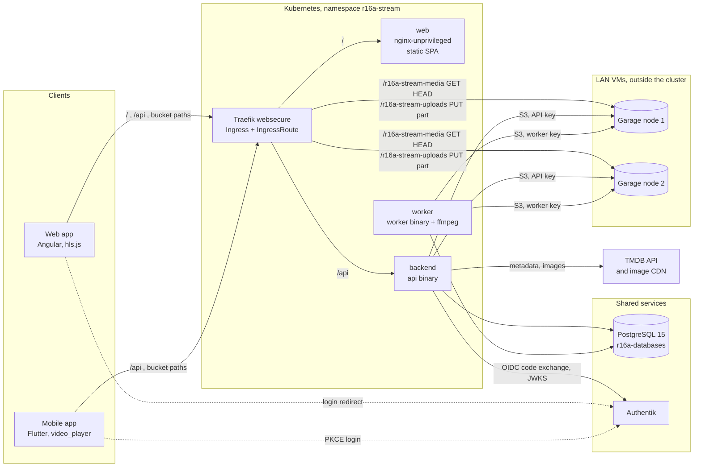
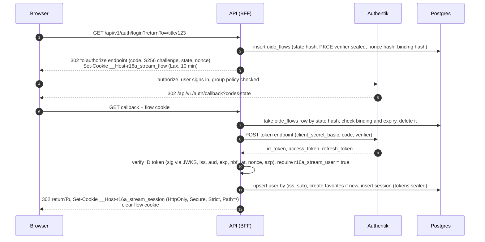
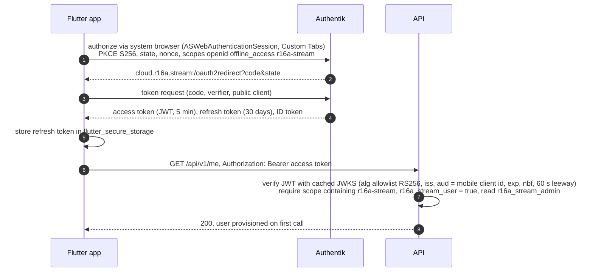
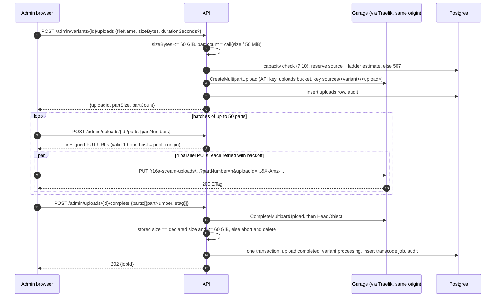
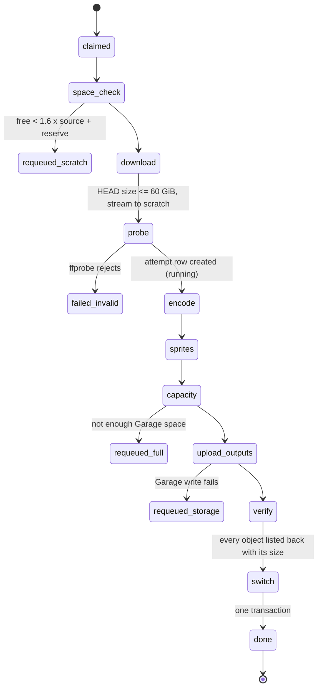

# r16a-stream specification

Status: **Phase 0 approved with amendments** (2026-11-18, second round the same day). Section 21 records how each conflict was resolved. This is the source of truth. `docs/DECISIONS.md` explains why, `docs/THREAT_MODEL.md` covers abuse, `docs/OPERATING.md` covers running it.

r16a-stream is a working name. Code, env vars and resource names use `r16a-stream` / `r16a_stream` / `R16A_`. The public hostname and the mobile app id live only in configuration (section 17, OPERATING 9).

Conventions follow Zaltys (`Ramphy0x90/r16a-vault`). Where this spec deviates from the brief, it says so in section 21.

---

## 1. Goals, scope and non-goals

**Goals**
- Private streaming of movies and TV shows for the members of one Authentik group.
- Security first, then performance, then everything else.
- Self-hosted on the existing r16a cluster (kubeadm, Calico OSS, Traefik, cert-manager), the shared PostgreSQL 15 and a two-node Garage cluster.

**Scale assumptions** (they size indexes, pools and budgets, and are re-checked if reality differs)
- Up to 10 000 titles, 100 000 episodes, 30 000 variants, 200 users, 10 concurrent streams.
- One API replica and one worker replica at start. Nothing may assume a single replica. Rate limits are per replica and documented as such (section 16).

**Non-goals**
- No public sign-up, no login other than Authentik.
- No DRM, no offline downloads, no live streaming, no transcoding on the fly.
- No per-UI-language metadata translations (title name and overview exist in one metadata language). Kept possible, see section 23.
- No social graph beyond sharing a list read-only and public comments.

---

## 2. Architecture

### 2.1 Components



| Component | Binary or image | Talks to | Never talks to |
|---|---|---|---|
| web | `r16a-stream-web` (nginx-unprivileged) | nothing, serves files | API, Garage |
| backend | `r16a-stream-backend`, `api` binary | Postgres (app role), Garage S3 (API key), Garage metrics (read-only token), Authentik, TMDB | ffmpeg |
| worker | `r16a-stream-worker`, `worker` binary | Postgres (worker role), Garage S3 (worker key) | Internet, Authentik, TMDB, Garage admin and RPC ports (NetworkPolicy, section 19.4) |
| migrate | init container in the backend pod, `api migrate` | Postgres as the owner role | anything else |

### 2.2 Request routing on the single host

All traffic uses one origin, `https://stream.r16a.cloud` today (configurable).

| Path | Methods | Target | Notes |
|---|---|---|---|
| `/api/...` | any | backend :8081 | JSON API, BFF login, playlists |
| `/r16a-stream-media/<key>` | GET, HEAD | Garage :3900 | presigned only, section 10.3 |
| `/r16a-stream-uploads/<key>?partNumber=..&uploadId=..` | PUT | Garage :3900 | presigned multipart parts only |
| `/r16a-stream-media`, `/r16a-stream-uploads` anything else | any | 403 | lowest-priority catch-all |
| `/` | GET, HEAD | web :8080 | SPA, `index.html` fallback |

`/healthz` and `/readyz` exist on the backend and worker ports but are not routed by the Ingress.

### 2.3 Backend crate

One crate `r16a-stream-backend`, edition 2024, two binaries.

- `bin/api.rs`. Subcommands `serve` (default), `migrate`, `healthcheck`, `openapi` (prints the document), `seed` (dev and CI only, refuses when `R16A_ENV=production`).
- `bin/worker.rs`. Subcommands `run` (default), `healthcheck`. Wires only `config`, `error`, `storage`, `transcode`, `images`, `catalog::repository` pieces it needs and the job queue.

Feature modules split into `dto.rs`, `handlers.rs` (HTTP only), `service.rs` (rules) and `repository.rs` (SQL only, `sqlx::query!`). The layout is in `backend/CLAUDE.md`.

---

## 3. Domain concepts

- **Title** is a movie or a show. Shows have **seasons** and **episodes**.
- **Media variant** is one language of one movie or one episode, a separate full encoded copy with its own video and audio. It is the playable unit.
- **Transcode attempt** is one run of the encoder for a variant, written to its own storage prefix. A variant points at exactly one current attempt once it is ready.
- **Rendition** is one quality of an attempt (1080p, 720p, 480p, 360p, capped at the source height).
- **Subtitle track** is an optional WebVTT file attached to a variant.
- **Content language** (variant) and **UI language** (settings) are separate. Both are BCP 47 tags. Content language is validated against the pattern `^[a-z]{2,3}(-[A-Za-z0-9]{2,8})*$` and normalised to lowercase language and title-case region by the service (for example `pt-BR`).
- **Favorites** is a system list per user, created at provisioning, never deleted or renamed. Like and dislike are a separate reaction per title.

---

## 4. Data model (PostgreSQL 15)

Rules
- Migrations are forward only, embedded with `sqlx::migrate!`, applied by the `migrate` init container as `r16a_stream_owner`.
- Primary keys use built-in `gen_random_uuid()` (PG13+). Nothing newer than PG15 is used. No `uuidv7()` (PG18), no `MERGE ... RETURNING` (PG17), no `ON DELETE SET NULL (col)` restrictions beyond PG15 syntax.
- Every `text` column has a length check. Every enum-like column is `text` with a `check` list, so adding a value is one migration.
- Timestamps are `timestamptz`, set by the database with `now()` unless the service states otherwise.

### 4.1 Extensions and helpers

```sql
-- pg_trgm and unaccent are trusted extensions since PG13, so the owner role can create
-- them because it owns the database. No superuser is needed at runtime or in migrations.
create extension if not exists pg_trgm;
create extension if not exists unaccent;

-- unaccent() is only STABLE because its dictionary could change, so it cannot be used in
-- an index or a generated column. Pinning the dictionary makes this wrapper safe to mark
-- IMMUTABLE. PG14+ SQL-standard body.
create function f_unaccent(text) returns text
  language sql immutable parallel safe strict
  return public.unaccent('public.unaccent'::regdictionary, $1);
```

### 4.2 Users, sessions, login flows

```sql
create table users (
  id                        uuid primary key default gen_random_uuid(),
  oidc_issuer               text not null check (char_length(oidc_issuer) <= 512),
  oidc_subject              text not null check (char_length(oidc_subject) <= 255),
  display_name              text not null check (char_length(display_name) between 1 and 100),
  is_admin                  boolean not null default false,  -- last seen claim, display and audit only
  ui_language               text not null default 'en' check (ui_language ~ '^[a-z]{2,3}(-[A-Za-z0-9]{2,8})*$'),
  theme                     text not null default 'dark' check (theme in ('dark', 'light', 'system')),
  preferred_audio_language  text check (preferred_audio_language ~ '^[a-z]{2,3}(-[A-Za-z0-9]{2,8})*$'),
  created_at                timestamptz not null default now(),
  last_seen_at              timestamptz not null default now(),
  disabled_at               timestamptz,
  sessions_revoked_at       timestamptz,   -- bearer tokens issued at or before this are refused, section 6.8
  unique (oidc_issuer, oidc_subject)
);
create index users_display_name_trgm_idx on users using gin (f_unaccent(lower(display_name)) gin_trgm_ops);

-- Web BFF sessions. Mobile has no server session, it presents Authentik access tokens.
create table sessions (
  id                   uuid primary key,          -- chosen by the API before sealing, the AAD names it
  user_id              uuid not null references users (id) on delete cascade,
  token_hash           bytea not null unique check (octet_length(token_hash) = 32),  -- SHA-256 of the cookie value
  is_admin             boolean not null,          -- from the last ID token, re-read on every refresh
  refresh_token_enc    bytea not null,            -- XChaCha20-Poly1305 with R16A_SESSION_KEY, AAD bound to the session id
  key_id               smallint not null,         -- which session key sealed refresh_token_enc
  claims_refreshed_at  timestamptz not null default now(),  -- refresh runs under a row lock, Authentik rotates refresh tokens
  created_at           timestamptz not null default now(),
  last_seen_at         timestamptz not null default now(),
  idle_expires_at      timestamptz not null,
  absolute_expires_at  timestamptz not null,
  user_agent           text check (char_length(user_agent) <= 256)
);
create index sessions_user_idx on sessions (user_id);
create index sessions_expiry_idx on sessions (idle_expires_at);

-- In-flight authorization code flows. Rows live at most 10 minutes.
create table oidc_flows (
  state_hash         bytea primary key check (octet_length(state_hash) = 32),
  browser_binding    bytea not null check (octet_length(browser_binding) = 32),  -- SHA-256 of the flow cookie
  pkce_verifier_enc  bytea not null,             -- sealed like refresh tokens, AAD bound to the state hash
  key_id             smallint not null,
  nonce_hash         bytea not null check (octet_length(nonce_hash) = 32),
  return_to          text not null check (char_length(return_to) <= 512),        -- same-origin path, validated
  created_at         timestamptz not null default now(),
  expires_at         timestamptz not null
);
create index oidc_flows_expiry_idx on oidc_flows (expires_at);
```

### 4.3 Images

```sql
create table images (
  id               uuid primary key default gen_random_uuid(),
  kind             text not null check (kind in ('poster', 'backdrop', 'still', 'profile')),
  status           text not null default 'pending' check (status in ('pending', 'ready', 'failed')),
  source_key       text not null check (char_length(source_key) <= 512),  -- uploads bucket, kept (small)
  source_bytes     bigint check (source_bytes > 0),
  source_width     integer check (source_width between 1 and 16384),
  source_height    integer check (source_height between 1 and 16384),
  placeholder_hsl  text check (placeholder_hsl ~ '^[0-9]{1,3} [0-9]{1,3}% [0-9]{1,3}%$'),  -- average colour for skeletons
  created_at       timestamptz not null default now(),
  ready_at         timestamptz
);

create table image_variants (
  image_id    uuid not null references images (id) on delete cascade,
  format      text not null check (format in ('avif', 'webp')),
  width       smallint not null check (width between 16 and 4096),
  height      smallint not null check (height between 16 and 4096),
  object_key  text not null check (char_length(object_key) <= 512),       -- media bucket
  byte_size   integer not null check (byte_size > 0),
  primary key (image_id, format, width)
);
```

Widths: posters and stills 185, 342, 500, 780. Backdrops 780, 1280, 1920. Profiles 185. Never wider than the source.

### 4.4 Catalog

```sql
create table genres (
  id       smallint generated always as identity primary key,
  slug     text not null unique check (slug ~ '^[a-z0-9-]{2,40}$'),  -- also the i18n key genre.<slug>
  name     text not null check (char_length(name) between 1 and 60), -- fallback when no translation exists
  tmdb_id  integer unique
);

create table titles (
  id                 uuid primary key default gen_random_uuid(),
  kind               text not null check (kind in ('movie', 'show')),
  name               text not null check (char_length(name) between 1 and 300),
  original_name      text check (char_length(original_name) <= 300),
  sort_name          text not null check (char_length(sort_name) between 1 and 300),  -- lower, unaccented, set by the service
  overview           text check (char_length(overview) <= 5000),
  year               smallint check (year between 1870 and 2200),
  runtime_minutes    integer check (runtime_minutes between 1 and 1440),  -- movies, shows use episodes
  tmdb_id            integer,
  poster_image_id    uuid references images (id) on delete set null,
  backdrop_image_id  uuid references images (id) on delete set null,
  status             text not null default 'draft' check (status in ('draft', 'published')),
  listed_at          timestamptz,  -- sort key of Recently added, set on first publish, bumped when a new episode becomes ready
  created_at         timestamptz not null default now(),
  updated_at         timestamptz not null default now(),
  search_doc         tsvector generated always as (
                       setweight(to_tsvector('simple', f_unaccent(name)), 'A') ||
                       setweight(to_tsvector('simple', f_unaccent(coalesce(original_name, ''))), 'A') ||
                       setweight(to_tsvector('simple', f_unaccent(coalesce(overview, ''))), 'D')
                     ) stored,
  unique (id, kind),        -- target of the composite keys that pin seasons to shows and variants to the right kind
  unique (kind, tmdb_id),
  check (status = 'draft' or listed_at is not null)
);
create index titles_recent_idx      on titles (listed_at desc, id desc) where status = 'published';
create index titles_kind_recent_idx on titles (kind, listed_at desc, id desc) where status = 'published';
create index titles_name_idx        on titles (sort_name, id) where status = 'published';
create index titles_search_idx      on titles using gin (search_doc);
create index titles_name_trgm_idx   on titles using gin (f_unaccent(lower(name)) gin_trgm_ops);

create table title_genres (
  title_id  uuid not null references titles (id) on delete cascade,
  genre_id  smallint not null references genres (id) on delete cascade,
  primary key (title_id, genre_id)
);
create index title_genres_genre_idx on title_genres (genre_id, title_id);

-- Denormalised set of content languages with at least one ready variant. Maintained by the
-- service in the same transaction that changes a variant's readiness, so the language filter
-- is one index probe instead of a join through episodes and variants.
create table title_languages (
  title_id  uuid not null references titles (id) on delete cascade,
  language  text not null check (char_length(language) <= 35),
  primary key (title_id, language)
);
create index title_languages_language_idx on title_languages (language, title_id);

create table title_credits (
  title_id         uuid not null references titles (id) on delete cascade,
  ord              smallint not null check (ord between 0 and 49),
  person_name      text not null check (char_length(person_name) between 1 and 200),
  character        text check (char_length(character) <= 200),
  role             text not null check (role in ('cast', 'director', 'creator', 'writer')),
  profile_image_id uuid references images (id) on delete set null,
  primary key (title_id, role, ord)
);

create table seasons (
  id               uuid primary key default gen_random_uuid(),
  title_id         uuid not null,
  title_kind       text not null default 'show' check (title_kind = 'show'),
  number           smallint not null check (number between 0 and 999),  -- 0 holds specials
  name             text check (char_length(name) <= 300),
  overview         text check (char_length(overview) <= 5000),
  year             smallint check (year between 1870 and 2200),
  poster_image_id  uuid references images (id) on delete set null,
  created_at       timestamptz not null default now(),
  updated_at       timestamptz not null default now(),
  foreign key (title_id, title_kind) references titles (id, kind) on delete cascade,
  unique (title_id, number),
  unique (id, title_id)
);

create table episodes (
  id               uuid primary key default gen_random_uuid(),
  season_id        uuid not null,
  title_id         uuid not null,
  number           smallint not null check (number between 1 and 9999),
  name             text check (char_length(name) <= 300),
  overview         text check (char_length(overview) <= 5000),
  runtime_minutes  integer check (runtime_minutes between 1 and 1440),
  air_date         date,
  still_image_id   uuid references images (id) on delete set null,
  created_at       timestamptz not null default now(),
  updated_at       timestamptz not null default now(),
  foreign key (season_id, title_id) references seasons (id, title_id) on delete cascade,
  unique (season_id, number),
  unique (id, title_id)
);
create index episodes_title_idx on episodes (title_id);
```

The composite keys make it impossible to attach a season to a movie or to change a show with seasons into a movie, at the database level (checked in Phase 3). The migration adds `check (kind = 'movie' or runtime_minutes is null)`, `titles_kind_name_idx` for A to Z with a type filter, `titles_admin_idx (updated_at desc, id desc)` for the admin list and `tmdb_cache_expiry_idx`. Images and image variants exist as tables from Phase 3a, the pipeline that fills them is Phase 3b.

### 4.5 Variants, uploads, attempts, renditions, subtitles

```sql
create table media_variants (
  id                  uuid primary key default gen_random_uuid(),
  title_id            uuid not null,
  title_kind          text not null check (title_kind in ('movie', 'show')),
  episode_id          uuid,
  language            text not null check (language ~ '^[a-z]{2,3}(-[A-Za-z0-9]{2,8})*$'),
  status              text not null default 'awaiting_upload'
                        check (status in ('awaiting_upload', 'processing', 'ready', 'failed')),
  current_attempt_id  uuid,         -- foreign key added below, after transcode_attempts
  duration_ms         bigint check (duration_ms > 0),
  created_at          timestamptz not null default now(),
  updated_at          timestamptz not null default now(),
  ready_at            timestamptz,
  foreign key (title_id, title_kind) references titles (id, kind) on delete cascade,
  foreign key (episode_id, title_id) references episodes (id, title_id) on delete cascade,
  check ((title_kind = 'movie') = (episode_id is null)),
  -- A re-transcode of a ready variant keeps it ready on the old attempt until the new one switches.
  check ((status = 'ready') = (current_attempt_id is not null)),
  unique (id, title_id)
);
create unique index media_variants_movie_lang_idx   on media_variants (title_id, language)   where episode_id is null;
create unique index media_variants_episode_lang_idx on media_variants (episode_id, language) where episode_id is not null;
create index media_variants_title_idx on media_variants (title_id);

create table uploads (
  id                 uuid primary key default gen_random_uuid(),
  purpose            text not null check (purpose in ('video_source', 'image_source')),
  variant_id         uuid references media_variants (id) on delete set null,
  image_id           uuid references images (id) on delete set null,
  object_key         text not null unique check (char_length(object_key) <= 512),  -- uploads bucket
  s3_upload_id       text not null check (char_length(s3_upload_id) <= 256),
  size_bytes         bigint not null check (size_bytes between 1 and 64424509440),  -- 60 GiB
  part_size          integer not null check (part_size = 52428800),                 -- 50 MiB
  part_count         integer not null check (part_count between 1 and 1229),
  original_filename  text check (char_length(original_filename) <= 255),
  status             text not null default 'initiated' check (status in ('initiated', 'completed', 'aborted')),
  estimated_output_bytes bigint not null default 0 check (estimated_output_bytes >= 0),  -- ladder estimate, section 7.10
  reserved_bytes     bigint not null default 0 check (reserved_bytes >= 0),  -- released when the transcode ends
  source_deleted_at  timestamptz,           -- set when retention removed the object, section 7.9
  created_by         uuid not null references users (id),
  created_at         timestamptz not null default now(),
  completed_at       timestamptz,
  expires_at         timestamptz not null    -- initiated uploads past this are aborted by the cleanup task
);
create index uploads_variant_idx  on uploads (variant_id, created_at desc);
create index uploads_stale_idx    on uploads (expires_at) where status = 'initiated';
create index uploads_reserved_idx on uploads (id) where reserved_bytes > 0;
create index uploads_retention_idx on uploads (completed_at) where status = 'completed' and source_deleted_at is null;

create table jobs (
  id              uuid primary key default gen_random_uuid(),
  kind            text not null check (kind in ('transcode', 'image', 'subtitle', 'encode_gc')),
  payload         jsonb not null default '{}'::jsonb,   -- ids only, never URLs or secrets
  status          text not null default 'queued'
                    check (status in ('queued', 'running', 'cancelling', 'succeeded', 'failed', 'cancelled')),
  priority        smallint not null default 0,
  attempts        smallint not null default 0,          -- counts real failures only
  max_attempts    smallint not null default 3,
  storage_waits   integer not null default 0,           -- requeues caused by storage or scratch, not failures
  blocked_reason  text check (blocked_reason in ('storage_degraded', 'storage_full', 'scratch_full')),
  run_after       timestamptz not null default now(),
  locked_by       text check (char_length(locked_by) <= 128),
  heartbeat_at    timestamptz,
  progress        real check (progress between 0 and 1),
  failure_code    text check (char_length(failure_code) <= 64),
  failure_detail  text check (char_length(failure_detail) <= 2000),  -- sanitised, never contains URLs or keys
  dedupe_key      text check (char_length(dedupe_key) <= 200),
  variant_id      uuid references media_variants (id) on delete cascade,
  image_id        uuid references images (id) on delete cascade,
  created_at      timestamptz not null default now(),
  started_at      timestamptz,
  finished_at     timestamptz
);
create index jobs_claim_idx     on jobs (priority desc, run_after, id) where status = 'queued';
create index jobs_running_idx   on jobs (heartbeat_at) where status in ('running', 'cancelling');
create index jobs_admin_idx     on jobs (created_at desc, id desc);
create index jobs_variant_idx   on jobs (variant_id, created_at desc);
create unique index jobs_dedupe_idx on jobs (dedupe_key) where status in ('queued', 'running', 'cancelling');

create table transcode_attempts (
  id                 uuid primary key default gen_random_uuid(),
  variant_id         uuid not null references media_variants (id) on delete cascade,
  upload_id          uuid not null references uploads (id),
  job_id             uuid references jobs (id) on delete set null,
  encoder            text not null check (encoder in ('x264', 'qsv', 'vaapi')),
  storage_prefix     text not null unique check (char_length(storage_prefix) <= 200),  -- v/<variant>/<attempt>/
  status             text not null default 'running' check (status in ('running', 'ready', 'failed', 'abandoned')),
  duration_ms        bigint check (duration_ms > 0),
  audio_codecs       text check (char_length(audio_codecs) <= 64),
  audio_channels     smallint check (audio_channels between 1 and 8),
  audio_playlist_key text check (char_length(audio_playlist_key) <= 512),
  scrub_vtt_key      text check (char_length(scrub_vtt_key) <= 512),
  total_bytes        bigint check (total_bytes > 0),     -- sum of every object under the prefix, measured after upload
  verified_at        timestamptz,                         -- every object listed back with the expected size
  created_at         timestamptz not null default now(),
  finished_at        timestamptz,
  unique (id, variant_id),
  check (status <> 'ready' or (verified_at is not null and total_bytes is not null))
);
create index transcode_attempts_variant_idx on transcode_attempts (variant_id, created_at desc);

alter table media_variants
  add foreign key (current_attempt_id, id) references transcode_attempts (id, variant_id);

create table renditions (
  attempt_id         uuid not null references transcode_attempts (id) on delete cascade,
  height             smallint not null check (height between 144 and 1080),  -- a ladder rung, or the source height below 360
  width              smallint not null check (width between 16 and 4096),
  bandwidth          integer not null check (bandwidth > 0),          -- peak, bits per second, measured
  average_bandwidth  integer not null check (average_bandwidth > 0),
  codecs             text not null check (char_length(codecs) <= 64),
  frame_rate         numeric(6, 3) not null check (frame_rate > 0),
  playlist_key       text not null check (char_length(playlist_key) <= 512),
  primary key (attempt_id, height)
);

create table subtitle_tracks (
  id           uuid primary key default gen_random_uuid(),
  variant_id   uuid not null references media_variants (id) on delete cascade,
  language     text not null check (language ~ '^[a-z]{2,3}(-[A-Za-z0-9]{2,8})*$'),
  label        text check (char_length(label) <= 60),
  kind         text not null default 'subtitles' check (kind in ('subtitles', 'captions', 'forced')),
  status       text not null default 'pending' check (status in ('pending', 'ready', 'failed')),
  staged_key   text not null check (char_length(staged_key) <= 512),   -- uploads bucket
  object_key   text check (char_length(object_key) <= 512),            -- media bucket once ready
  byte_size    integer check (byte_size between 1 and 2097152),
  created_at   timestamptz not null default now(),
  unique (variant_id, language, kind)
);

-- Latest write probe and encoder per running instance, for the admin storage view.
create table component_health (
  component         text not null check (component in ('api', 'worker')),
  instance          text not null check (char_length(instance) <= 128),   -- pod name
  storage_writable  boolean not null,
  encoder           text check (char_length(encoder) <= 32),               -- worker only, shows a fallback
  checked_at        timestamptz not null default now(),
  primary key (component, instance)
);

-- Disk space per Garage node, polled by the API from the read-only metrics endpoint and read by
-- the worker before it writes outputs. The worker cannot reach the metrics port itself.
create table garage_capacity (
  node            text primary key check (char_length(node) <= 128),  -- metrics endpoint the row came from
  data_avail      bigint not null check (data_avail >= 0),
  data_total      bigint not null check (data_total >= 0),
  meta_avail      bigint check (meta_avail >= 0),
  meta_total      bigint check (meta_total >= 0),
  replication     smallint not null check (replication between 1 and 7),
  checked_at      timestamptz not null default now()
);

-- Encode GC bookkeeping. A prefix must be seen orphaned for 24 hours before deletion.
create table gc_orphans (
  bucket         text not null check (bucket in ('media', 'uploads')),
  prefix         text not null check (char_length(prefix) <= 512),
  first_seen_at  timestamptz not null default now(),
  last_seen_at   timestamptz not null default now(),
  primary key (bucket, prefix)
);
```

### 4.6 Playback progress and reactions

```sql
create table watch_progress (
  user_id      uuid not null references users (id) on delete cascade,
  variant_id   uuid not null references media_variants (id) on delete cascade,
  title_id     uuid not null references titles (id) on delete cascade,     -- denormalised for Continue watching
  episode_id   uuid references episodes (id) on delete cascade,
  position_ms  bigint not null check (position_ms >= 0),
  duration_ms  bigint not null check (duration_ms > 0),
  completed    boolean not null default false,
  updated_at   timestamptz not null default now(),
  primary key (user_id, variant_id)
);
create index watch_progress_recent_idx on watch_progress (user_id, updated_at desc);
create index watch_progress_title_idx  on watch_progress (user_id, title_id, updated_at desc);

create table title_reactions (
  user_id     uuid not null references users (id) on delete cascade,
  title_id    uuid not null references titles (id) on delete cascade,
  value       smallint not null check (value in (-1, 1)),   -- dislike, like. No row means neither.
  updated_at  timestamptz not null default now(),
  primary key (user_id, title_id)
);
create index title_reactions_title_idx on title_reactions (title_id);
```

### 4.7 Lists, favorites and sharing

```sql
create table lists (
  id          uuid primary key default gen_random_uuid(),
  owner_id    uuid not null references users (id) on delete cascade,
  kind        text not null check (kind in ('favorites', 'custom')),
  name        text check (char_length(name) between 1 and 100),
  position    integer not null default 0,
  created_at  timestamptz not null default now(),
  updated_at  timestamptz not null default now(),
  check ((kind = 'favorites') = (name is null))   -- favorites has no name, the UI translates it
);
create unique index lists_one_favorites_idx on lists (owner_id) where kind = 'favorites';
create index lists_owner_idx on lists (owner_id, position, id);

create table list_items (
  list_id   uuid not null references lists (id) on delete cascade,
  title_id  uuid not null references titles (id) on delete cascade,
  position  bigint not null,               -- sparse, gaps of 1024, renumbered on collision
  added_at  timestamptz not null default now(),
  primary key (list_id, title_id)
);
create index list_items_order_idx on list_items (list_id, position, title_id);
create index list_items_added_idx on list_items (list_id, added_at desc, title_id);
create index list_items_title_idx on list_items (title_id);

create table list_shares (
  list_id     uuid not null references lists (id) on delete cascade,
  user_id     uuid not null references users (id) on delete cascade,
  created_at  timestamptz not null default now(),
  primary key (list_id, user_id)
);
create index list_shares_user_idx on list_shares (user_id, created_at desc);
```

Rules enforced in `lists/service.rs` and covered by tests: favorites cannot be renamed, deleted or shared. Only custom lists are shareable. A list cannot be shared with its owner. At most 100 lists per user, 5 000 items per list, 50 shares per list.

### 4.8 Comments, requests, audit, TMDB cache

```sql
create table comments (
  id          uuid primary key default gen_random_uuid(),
  title_id    uuid not null references titles (id) on delete cascade,
  author_id   uuid not null references users (id) on delete cascade,
  body        text not null check (char_length(body) between 1 and 2000),
  visibility  text not null default 'private' check (visibility in ('private', 'public')),
  hidden_at   timestamptz,
  hidden_by   uuid references users (id) on delete set null,
  created_at  timestamptz not null default now(),
  edited_at   timestamptz
);
create index comments_public_idx on comments (title_id, created_at desc, id desc)
  where visibility = 'public' and hidden_at is null;
create index comments_author_idx on comments (author_id, title_id, created_at desc);
create index comments_moderation_idx on comments (created_at desc, id desc) where visibility = 'public';

create table requests (
  id                  uuid primary key default gen_random_uuid(),
  kind                text not null check (kind in ('movie', 'show', 'language')),
  tmdb_id             integer,
  title_id            uuid references titles (id) on delete set null,   -- language requests and fulfilment
  language            text check (language ~ '^[a-z]{2,3}(-[A-Za-z0-9]{2,8})*$'),
  name                text not null check (char_length(name) between 1 and 300),
  year                smallint check (year between 1870 and 2200),
  note                text check (char_length(note) <= 1000),
  dedupe_key          text not null check (char_length(dedupe_key) <= 400),
  status              text not null default 'pending'
                        check (status in ('pending', 'approved', 'rejected', 'fulfilled')),
  created_by          uuid not null references users (id) on delete cascade,
  decided_by          uuid references users (id) on delete set null,
  decided_at          timestamptz,
  decision_note       text check (char_length(decision_note) <= 1000),
  vote_count          integer not null default 1 check (vote_count >= 0),  -- kept in step with request_votes
  created_at          timestamptz not null default now(),
  check (kind <> 'language' or (title_id is not null and language is not null))
);
-- One open request per dedupe key. A rejected or fulfilled request can be requested again.
create unique index requests_open_dedupe_idx on requests (dedupe_key) where status in ('pending', 'approved');
create index requests_queue_idx   on requests (status, vote_count desc, created_at, id);
create index requests_creator_idx on requests (created_by, created_at desc, id desc);

create table request_votes (
  request_id  uuid not null references requests (id) on delete cascade,
  user_id     uuid not null references users (id) on delete cascade,
  created_at  timestamptz not null default now(),
  primary key (request_id, user_id)
);
create index request_votes_user_idx on request_votes (user_id, created_at desc);

-- Append only. The app role gets INSERT and SELECT here, UPDATE and DELETE are revoked.
create table audit_log (
  id           bigint generated always as identity primary key,
  actor_id     uuid references users (id) on delete set null,
  action       text not null check (char_length(action) <= 64),     -- for example title.publish
  target_kind  text not null check (char_length(target_kind) <= 32),
  target_id    text check (char_length(target_id) <= 64),
  details      jsonb not null default '{}'::jsonb,                    -- changed field names and ids, never secrets
  request_id   text check (char_length(request_id) <= 64),
  created_at   timestamptz not null default now()
);
create index audit_log_recent_idx on audit_log (created_at desc, id desc);
create index audit_log_target_idx on audit_log (target_kind, target_id, created_at desc);

create table tmdb_cache (
  cache_key   text primary key check (char_length(cache_key) <= 200),  -- kind, TMDB id and language, built in tmdb/service.rs
  payload     jsonb not null,
  fetched_at  timestamptz not null default now(),
  expires_at  timestamptz not null
);
```

Dedupe keys, computed by `requests/service.rs`:
- with a TMDB id, `tmdb:movie:<id>` or `tmdb:tv:<id>`
- a language request, `lang:<title_id>:<language>`
- without either, `name:<kind>:<f_unaccent(lower(trim(name)))>:<year or ->`

A title already in the catalog with the same TMDB id makes a movie or show request fail with `already_available` and a link to it.

### 4.9 Database roles

| Role | Used by | Rights |
|---|---|---|
| `r16a_stream_owner` | `migrate` init container only (`R16A_MIGRATE_DATABASE_URL`) | owns the database and schema `public`, creates extensions |
| `r16a_stream_app` | api | `CONNECT`, `USAGE` on `public`, `SELECT, INSERT, UPDATE, DELETE` on tables and `USAGE, SELECT` on sequences via default privileges. On `audit_log`, `UPDATE` and `DELETE` are revoked by migration. |
| `r16a_stream_worker` | worker | `CONNECT`, `USAGE` on `public`, and only the table and column grants below. No default privileges, so a new table is invisible to the worker until a migration grants it. |

All three are created by `deploy/k8s/provision.sql` (production), `deploy/compose/init-roles.sh` (compose) and the CI provisioning step, with the same names everywhere. Roles are created there because creating roles needs `CREATEROLE`, which the owner does not have. Grants are in migrations, run by the owner, so they version with the schema. Same pattern as Zaltys decision 012.

Worker grants, in the migration that creates the tables:

```sql
grant select, insert, update on jobs to r16a_stream_worker;                      -- claim, heartbeat, finish, enqueue the next GC
grant select on media_variants to r16a_stream_worker;
grant update (status, current_attempt_id, duration_ms, ready_at, updated_at) on media_variants to r16a_stream_worker;
grant select, insert, update on transcode_attempts to r16a_stream_worker;
grant select, insert on renditions to r16a_stream_worker;
grant select (id, purpose, variant_id, image_id, object_key, size_bytes, status, reserved_bytes) on uploads to r16a_stream_worker;
grant update (reserved_bytes) on uploads to r16a_stream_worker;
grant select (id, kind, status, source_key, source_bytes) on images to r16a_stream_worker;
grant update (status, source_width, source_height, placeholder_hsl, ready_at) on images to r16a_stream_worker;
grant select, insert, delete on image_variants to r16a_stream_worker;
grant select (id, variant_id, language, kind, status, staged_key, object_key) on subtitle_tracks to r16a_stream_worker;
grant update (status, object_key, byte_size) on subtitle_tracks to r16a_stream_worker;
grant select, insert on title_languages to r16a_stream_worker;
grant select (id, kind, status, listed_at) on titles to r16a_stream_worker;
grant update (listed_at) on titles to r16a_stream_worker;
grant select (id, title_id, number) on seasons to r16a_stream_worker;
grant select (id, season_id, title_id, number) on episodes to r16a_stream_worker;
grant select, insert, update, delete on gc_orphans to r16a_stream_worker;
grant select, insert, update on component_health to r16a_stream_worker;
grant select on garage_capacity to r16a_stream_worker;
```

The worker has no access to `users`, `sessions`, `oidc_flows`, `comments`, `lists`, `list_items`, `list_shares`, `watch_progress`, `title_reactions`, `requests`, `request_votes`, `audit_log`, `tmdb_cache`, `uploads.s3_upload_id` or any text metadata of titles. `tests/db_roles.rs` connects as the worker and asserts `permission denied` for a representative read and write on each of these, the same way the Garage init proves the key scoping. It also asserts that the app role cannot update or delete `audit_log`.

### 4.10 Hot queries and their indexes

Every query below must be p95 under 50 ms at the database level. `cargo run --bin api -- seed --bench` (Phase 3) loads the scale from section 1, runs `EXPLAIN (ANALYZE, BUFFERS)` and removes its data. Results and plans are in `docs/perf/queries.md`, H1 to H5, H8 and H9 so far, all below 4 ms. Phase 6 adds H6, H7, H10 to H13.

| # | Query | Shape | Index |
|---|---|---|---|
| H1 | Home grid, recently added, optional kind | `status='published'`, order `listed_at desc, id desc`, keyset | `titles_recent_idx`, `titles_kind_recent_idx` |
| H2 | Home grid with genre filter | H1 plus `exists (title_genres where genre_id = $g)` | `title_genres_genre_idx` plus H1 |
| H3 | Home grid with language filter | H1 plus `exists (title_languages where language = $l)` | `title_languages_language_idx` plus H1 |
| H4 | A to Z order | `order by sort_name, id`, keyset | `titles_name_idx` |
| H5 | Search | `search_doc @@ websearch_to_tsquery('simple', f_unaccent($q))` or trigram similarity on name, ranked, keyset on `(rank, id)` | `titles_search_idx`, `titles_name_trgm_idx` |
| H6 | Continue watching (20 rows) | latest unfinished progress per title for a user | `watch_progress_recent_idx` |
| H7 | Favorites or list browse with filters | `list_items` join `titles`, keyset on `(position, title_id)` or `(added_at, title_id)` | `list_items_order_idx`, `list_items_added_idx` |
| H8 | Title page | title, genres, credits, seasons, the user's reaction, favorite state and progress, in a fixed number of queries | primary keys, `list_items_title_idx` |
| H9 | Episodes of a season with ready languages | episodes join variants where `status='ready'` | `episodes` unique `(season_id, number)`, `media_variants_title_idx` |
| H10 | Public comments of a title | keyset on `(created_at, id)` | `comments_public_idx` |
| H11 | Job claim | `for update skip locked limit 1` | `jobs_claim_idx` |
| H12 | Playlist request | variant, attempt and renditions by id | primary keys |
| H13 | Lists shared with me | `list_shares where user_id` | `list_shares_user_idx` |

No N+1. List endpoints load cards in one query, with poster variants fetched in one batched query per page (`image_id = any($1)`).

---

## 5. API outline

### 5.1 Conventions

- Base path `/api/v1`. JSON in and out, `camelCase`. Problem responses are RFC 9457 `application/problem+json` with `type` `urn:r16a-stream:problem:<slug>`, `title`, `status` and `requestId`, the Zaltys shape.
- Request bodies go through `ApiJson<T>` with `#[serde(deny_unknown_fields)]`. Default body limit 16 KiB, larger per route where stated.
- Every string field has a maximum length in the DTO, matching the column check.
- Ids are UUIDs. A malformed id is 404, not 400, so existence cannot be probed.
- Lists use **keyset pagination**: `?limit=` (1 to 60, default 30) and `?cursor=`, an opaque base64url value encoding the last sort key and id. Responses return `{ items, nextCursor }`.
- Filters are query parameters (`type`, `genre`, `language`, `q`, `sort`), so web URLs carry them.
- Catalog GET responses carry a weak `ETag` computed from the response body and honour `If-None-Match` with 304. `Cache-Control: private, no-cache`.
- Responses are Brotli or gzip compressed (`tower-http` compression), except playlists that are already tiny and segments that never pass the API.
- Auth extractors: `WebSession` (cookie plus CSRF), `Bearer` (mobile), `Caller` (either), `Admin` (either, admin flag true, otherwise **404**).

### 5.2 Endpoints

Legend: **C** caller (any signed-in user), **A** admin, **P** playback token in the path, **-** anonymous.

| Method and path | Auth | Purpose |
|---|---|---|
| `GET /status` | - | reachability check used by the web shell, `{ service, apiVersion }`, no versions or hostnames (Phase 1) |
| `GET /auth/login?returnTo=` | - | start BFF login, 302 to Authentik |
| `GET /auth/callback` | - | finish BFF login, set session cookie, 302 to `returnTo` |
| `POST /auth/logout` | C (web) | end session, returns `{ endSessionUrl }` for RP-initiated logout |
| `GET /me` | C | id, display name, admin flag, settings |
| `PATCH /me/settings` | C | theme, UI language, preferred audio language |
| `GET /users?q=` | C | find users to share a list with, display name only, min 2 characters |
| `GET /genres` | C | genres with slugs, ordered by name |
| `GET /languages` | C | content languages that have ready variants |
| `GET /titles?type&genre&language&q&sort&cursor&limit` | C | home grid and search |
| `GET /home/continue-watching` | C | up to 20 cards with progress |
| `GET /home/recently-added` | C | up to 20 cards |
| `GET /titles/{id}` | C | title page, includes reaction, favorite flag, languages, seasons |
| `GET /titles/{id}/seasons/{number}/episodes` | C | episodes with ready languages and progress |
| `PUT /titles/{id}/reaction` | C | `{ value: like, dislike, none }` |
| `PUT /favorites/{titleId}`, `DELETE /favorites/{titleId}` | C | add or remove a favorite |
| `GET /favorites?type&genre&language&sort&cursor` | C | browse favorites |
| `GET /lists` | C | favorites, own lists, shared with me |
| `POST /lists`, `PATCH /lists/{id}`, `DELETE /lists/{id}` | C owner | create, rename, delete a custom list |
| `PUT /lists/order` | C | reorder own lists, `{ ids: [...] }` |
| `GET /lists/{id}/items?filters&cursor` | C owner or shared | browse a list |
| `PUT /lists/{id}/items/{titleId}`, `DELETE ...` | C owner | add or remove a title |
| `PATCH /lists/{id}/items/{titleId}` | C owner | move, `{ after: titleId or null }` |
| `GET /lists/{id}/shares`, `PUT /lists/{id}/shares/{userId}`, `DELETE ...` | C owner | share read-only, revoke |
| `GET /titles/{id}/comments?cursor` | C | public comments plus the caller's own private ones |
| `POST /titles/{id}/comments` | C | create, private by default |
| `PATCH /comments/{id}`, `DELETE /comments/{id}` | C author | edit body or visibility, delete |
| `POST /playback` | C | `{ variantId }` returns master URL, subtitles, scrub map, resume point, next episode |
| `GET /play/{token}/master.m3u8` | P | master playlist |
| `GET /play/{token}/v/{height}.m3u8`, `GET /play/{token}/audio.m3u8` | P | media playlists with presigned segment URLs |
| `GET /play/{token}/scrub.vtt` | P | thumbnail map with presigned sprite URLs |
| `PUT /progress/{variantId}` | C | `{ positionMs, durationMs, event: tick, pause, exit, ended }` |
| `GET /requests?mine=true&status&cursor` | C | own requests, or all open requests for upvoting |
| `POST /requests` | C | create, or 200 with `{ duplicateOf }` and an automatic upvote |
| `PUT /requests/{id}/vote`, `DELETE ...` | C | upvote, withdraw |
| `GET /admin/storage` | A | write health (api and worker), Garage nodes up, used, free and total per node, logical free space, reserved bytes, warning flag (7.10) |
| `GET /admin/storage/titles?cursor` | A | storage per title, largest first, keyset on `(bytes, id)` |
| `GET /admin/titles/{id}/storage` | A | storage per variant of one title: current attempt, attempts awaiting GC, source if kept, subtitles, images |
| `GET /admin/tmdb/lookup?ref=&kind=` | A | parse a TMDB link or id, return a prefilled draft in the shape of `POST /admin/titles` |
| `GET /admin/titles?status&q&cursor&limit`, `GET /admin/titles/{id}` | A | every title, drafts included, last changed first, and one title with its seasons and episodes for the editor (added in Phase 3) |
| `POST /admin/titles`, `PATCH /admin/titles/{id}`, `DELETE ...` | A | manual or TMDB-prefilled title. Create takes genres, credits, seasons and episodes in one request, body limit 2 MiB |
| `POST /admin/genres` | A | a genre for titles entered by hand, `{ name }`, slug derived (added in Phase 3) |
| `POST /admin/titles/{id}/publish`, `POST .../unpublish` | A | visibility |
| `POST /admin/titles/{id}/seasons`, `PATCH /admin/seasons/{id}`, `DELETE /admin/seasons/{id}`, `POST /admin/seasons/{id}/episodes`, `PATCH /admin/episodes/{id}`, `DELETE /admin/episodes/{id}` | A | show structure. A season on a movie is `409 not-a-show`, a taken number `409` |
| `POST /admin/variants`, `DELETE /admin/variants/{id}` | A | a language for a movie or an episode |
| `POST /admin/variants/{id}/uploads` | A | start multipart upload `{ fileName, sizeBytes, durationSeconds? }`, `507 insufficient_storage` when the estimate does not fit (7.10), `503 storage_degraded` |
| `POST /admin/uploads/{id}/parts` | A | presigned part URLs `{ partNumbers: [..] }`, at most 50 per call |
| `GET /admin/uploads/{id}` | A | parts already stored, for resume |
| `POST /admin/uploads/{id}/complete` | A | `{ parts: [{ partNumber, etag }] }`, body limit 256 KiB, enqueues the transcode |
| `DELETE /admin/uploads/{id}` | A | abort |
| `POST /admin/variants/{id}/subtitles` | A | raw `text/vtt` body, 2 MiB limit, query `language`, `label`, `kind`. Staged in the uploads bucket, promoted to `s/<id>.vtt` by a `subtitle` job, the staged file deleted by the API afterwards |
| `DELETE /admin/subtitles/{id}` | A | remove a track |
| `POST /admin/images` | A | start a single-part multipart upload for a manual poster or backdrop |
| `GET /admin/jobs?status&kind&cursor`, `GET /admin/jobs/{id}` | A | queue, progress, failure reason |
| `POST /admin/jobs/{id}/retry`, `POST /admin/jobs/{id}/cancel` | A | control |
| `POST /admin/variants/{id}/retranscode` | A | new attempt from the stored source, `409 source_unavailable` once retention deleted it |
| `GET /admin/requests?status&cursor`, `POST /admin/requests/{id}/decision` | A | approve, reject, fulfil with a title |
| `GET /admin/comments?cursor`, `POST /admin/comments/{id}/hide`, `POST .../unhide` | A | moderation |
| `GET /admin/audit?cursor` | A | audit log |
| `GET /admin/users?q=&cursor` | A | find users by display name |
| `POST /admin/users/{id}/revoke-sessions` | A | end every web session of a user now and refuse their current mobile tokens (6.8) |

Every admin mutation writes an `audit_log` row in the same transaction.

Routes that write to Garage (`/admin/variants/{id}/uploads`, `/admin/uploads/{id}/parts`, `/admin/uploads/{id}/complete`, `/admin/images`, `/admin/variants/{id}/subtitles`, title saves that import TMDB images, deletes that remove sources) answer `503` with problem type `urn:r16a-stream:problem:storage_degraded` while the API's write probe fails (7.8). Every other route keeps working.

The exact schemas are generated into `docs/openapi.json` by utoipa and are authoritative once Phase 1 starts. This table is the outline the generator must match.

---

## 6. Authentication and authorisation

### 6.1 Authentik configuration

Authentik **2026.2.1**. Behaviour below was verified against the source of tag `version/2026.2.1` on 2026-11-18 (files `providers/oauth2/id_token.py`, `views/token.py`, `views/end_session.py`, `views/userinfo.py`, `core/expression/evaluator.py`), not assumed.

**Four providers.** Authentik binds one client type to one provider, and production and development must not share secrets or redirect URIs.

| Provider and application slug | Client type | Redirect URIs (strict) | Used by |
|---|---|---|---|
| `r16a-stream` | Confidential | `https://stream.r16a.cloud/api/v1/auth/callback` | production API (BFF) |
| `r16a-stream-mobile` | Public | `cloud.r16a.stream:/oauth2redirect` | release builds of the app |
| `r16a-stream-dev` | Confidential | `http://localhost:4200/api/v1/auth/callback`, `http://localhost:8080/api/v1/auth/callback` | `cargo run` with `ng serve`, prod-like compose, the CI stack |
| `r16a-stream-mobile-dev` | Public | `cloud.r16a.stream.dev:/oauth2redirect` | debug builds of the app against a local API |

The provider name equals the application slug, so the issuer and the end-session URL follow from it (`https://<authentik>/application/o/<slug>/`). The dev mobile build uses its own scheme, so a debug and a release build on the same phone never catch each other's redirects.

**Groups**
- `r16a-stream-users`, may sign in.
- `r16a-stream-admins`, admin. Admins must also be in `r16a-stream-users`.

**Scope mappings** (Customization, Property Mappings, Create, Scope Mapping). Two of them, both with scope name `r16a-stream`, so the CI groups can never reach the production applications (DECISIONS 051, 075).

| Name | Scope name | Selected on | Groups that count |
|---|---|---|---|
| `r16a-stream: access claims` | `r16a-stream` | `r16a-stream`, `r16a-stream-mobile` | `r16a-stream-users`, `r16a-stream-admins` |
| `r16a-stream-dev: access claims` | `r16a-stream` | `r16a-stream-dev`, `r16a-stream-mobile-dev` | the same, plus `r16a-stream-ci-users`, `r16a-stream-ci-admins` |

Production expression:

```python
active = request.user.is_active
return {
    "name": request.user.name,
    "preferred_username": request.user.username,
    "r16a_stream_user": active and ak_is_group_member(request.user, name="r16a-stream-users"),
    "r16a_stream_admin": active and ak_is_group_member(request.user, name="r16a-stream-admins"),
}
```

Dev expression, identical except for the two group checks:

```python
active = request.user.is_active
member = lambda *names: any(ak_is_group_member(request.user, name=n) for n in names)
return {
    "name": request.user.name,
    "preferred_username": request.user.username,
    "r16a_stream_user": active and member("r16a-stream-users", "r16a-stream-ci-users"),
    "r16a_stream_admin": active and member("r16a-stream-admins", "r16a-stream-ci-admins"),
}
```

- `name` and `preferred_username` come from this mapping, because the app does not request the `profile` scope. Authentik's default profile mapping also emits `groups` with every group name of the user, which the app must not see (DECISIONS 074).

- `request.user` is the token's user in every grant, including refresh at the token endpoint (the evaluator builds `PolicyRequest(user=token.user)`), so the expression is valid on refresh.
- `ak_is_group_member` checks `user.all_groups()`, so membership through a parent group also counts.
- `is_active` is included because the refresh grant in 2026.2.1 does not check whether the user is still active.
- The mapping reveals no group name (C3). No provider has the default `profile` or `email` mapping selected, so a client cannot ask for them either. The API logs a warning at startup when a provider offers them.
- Authentik only runs the mappings of scopes the client requested **and** the provider has selected, and silently drops a requested scope the provider lacks. A missing `offline_access` mapping therefore shows up as a token response without a refresh token, and a missing `r16a-stream` mapping as tokens without the two claims. The discovery document's `scopes_supported` lists exactly the selected mappings, which the API checks (6.3).

**Settings common to all four providers** (OAuth2/OpenID Provider)

| Setting | Value | Why |
|---|---|---|
| Authorization flow | web providers `default-provider-authorization-implicit-consent`. Mobile providers `r16a-stream-mobile-authorization`, a flow with one Consent stage in mode `always_require` | the web redirect goes to an exact https URI, so no other party can receive the code. The mobile redirect is a custom scheme that any Android app can also register. With silent consent a malicious app could start its own flow in a Custom Tab, ride on the Authentik browser session and receive a code for its own PKCE verifier. An explicit consent screen on every mobile login stops that. The default explicit-consent flow remembers consent for 4 weeks, so it is not enough (T-AUTH-11) |
| Invalidation flow | the provider's own logout flow, `r16a-stream-logout` and so on (6.1.1) | ends the Authentik session and sends the user back to the app, without touching the default flows |
| Signing key | an RSA certificate, for example `authentik Self-signed Certificate` | without a key Authentik signs with HS256 and the client secret, and public clients have no secret |
| Encryption key | none | tokens are JWS, not JWE |
| Scopes (selected mappings) | `authentik default OAuth Mapping: OpenID 'openid'`, `authentik default OAuth Mapping: OpenID 'offline_access'`, and that provider's `r16a-stream` mapping from the table above. Nothing else | without `offline_access` there is no refresh token. No `profile` and no `email`, they would put group names and the address into tokens |
| Subject mode | Based on the User's hashed ID (default) | stable, opaque, users are keyed by `sub` |
| Include claims in id_token | **on** (default) | in 2026.2.1 this flag also decides whether mapped claims appear in the JWT access token, which mobile needs |
| Issuer mode | Each provider has a different issuer (default) | `iss` pins the provider |
| Access code validity | `minutes=1` | |
| Access token validity | `minutes=5` | claims are re-read at least this often |
| Refresh token validity | `days=30` | matches the absolute web session lifetime |
| Refresh token threshold | `seconds=0` (default) | every refresh rotates the refresh token, see below |
| Logout method | Back-channel (default), Logout URI empty | back-channel logout is not implemented yet (section 23) |

**Applications.** One per provider, same slug. Each has exactly one binding under Policy / Group / User Bindings, a group binding to `r16a-stream-users`, policy engine mode `any`. Launch URL `https://stream.r16a.cloud/` (production) or `http://localhost:4200/` (dev).

**Verified behaviour of 2026.2.1 that the design relies on**
1. **Claims in access tokens.** `IDToken.to_access_token` encodes the same dictionary as the ID token, plus `azp`, `uid` and `scope`. With "Include claims in id_token" on, the two booleans are in the access token. `aud` is the client id in both tokens.
2. **No policy re-check on refresh.** The token endpoint evaluates application policies only for client credentials grants. A user removed from `r16a-stream-users` can keep refreshing until the refresh token expires. The API therefore treats `r16a_stream_user = false` in a refreshed token as the removal signal (C3).
3. **Claims are recomputed on refresh.** Every refresh builds a new ID token and access token through `IDToken.new`, which re-runs the scope mapping, so admin changes and removals show up at the next refresh.
4. **Refresh tokens rotate.** With threshold 0, every refresh issues a new refresh token and revokes the old one. Reusing a revoked one returns `invalid_grant` and logs a suspicious-request event. Both clients must store the new token and never refresh twice in parallel (6.3, 6.4).
5. **Logout redirect comes from the flow, not from parameters.** The end-session view ignores `id_token_hint` and `post_logout_redirect_uri`. It plans the provider's invalidation flow and appends a session-end stage. A Redirect stage placed after the User Logout stage in a provider-specific flow sends the user back before the session-end stage is reached (6.1.1). The app therefore stores no ID token and sends no hint. Re-check this on every Authentik upgrade (DECISIONS section C).

#### 6.1.1 Logout flows

Authentik 2026.2.1 has a Redirect stage (`authentik_stages_redirect`, static mode, target is any string). The User Logout stage calls `logout()` and then `stage_ok()`, which stores the remaining plan in the new session, so a stage after it still runs. Verified in the source on 2026-11-18. So each provider gets its own invalidation flow and the default flows stay untouched.

| Flow (designation Invalidation) | Stage order 10 | Stage order 20 (Redirect, static) | Used by provider |
|---|---|---|---|
| `r16a-stream-logout` | `r16a-stream-user-logout` (User Logout) | `r16a-stream-logout-redirect` to `https://stream.r16a.cloud/` | `r16a-stream` |
| `r16a-stream-dev-logout` | `r16a-stream-user-logout` | `r16a-stream-dev-logout-redirect` to `http://localhost:4200/` | `r16a-stream-dev` |
| `r16a-stream-mobile-logout` | `r16a-stream-user-logout` | `r16a-stream-mobile-logout-redirect` to `cloud.r16a.stream:/logout` | `r16a-stream-mobile` |
| `r16a-stream-mobile-dev-logout` | `r16a-stream-user-logout` | `r16a-stream-mobile-dev-logout-redirect` to `cloud.r16a.stream.dev:/logout` | `r16a-stream-mobile-dev` |

- Flow settings: authentication "No requirement", denied action "Message", no policy bindings on the flow. The User Logout stage is shared, each Redirect stage is not, because the target is static.
- The targets are fixed in Authentik, so nothing a client sends can turn this into an open redirect.
- Phase 2 checks the two parts the source cannot prove: that the browser follows the static redirect to the app, and that the custom-scheme redirect hands control back to `flutter_appauth`'s end-session call on both platforms. If the mobile part fails, the mobile flows fall back to ending at Authentik's page and the app closes the browser tab itself.

### 6.2 Why development has its own providers

The production redirect URIs stay exact and https only, a client secret on a laptop or a CI runner cannot mint sessions for the production app, and a debug phone build cannot hold production tokens. The API is configured with one web client and one mobile client id, so production and development tokens are never accepted by the wrong environment (`aud` and `iss` differ).

### 6.3 Web login (BFF)



- `returnTo` must be a same-origin absolute path that starts with a single `/` and contains no backslash, whitespace, control character or scheme. Anything else becomes `/`.
- **Setup errors.** Before redirecting to Authentik, the API checks that the provider's `scopes_supported` contains `openid`, `offline_access` and `r16a-stream`. At the callback, a token response without a refresh token, or an ID token without the `r16a_stream_user` claim at all (as opposed to `false`), is a setup error too. All three redirect to `/signin?error=setup&ref=<request id>`. The page shows the same neutral text to everyone plus the reference, and the API logs the exact missing setting under that request id, so an admin learns what to fix from the logs without the page telling anonymous visitors how Authentik is configured. At startup the API logs the same check for both providers. At most 10 000 login flows are kept alive at once, beyond that `GET /auth/login` answers 503.
- A failed callback (missing or foreign flow cookie, unknown or expired state, provider error, nonce or token check failed) redirects to `/signin?error=failed`. A token without `r16a_stream_user = true`, or a disabled user, redirects to `/signin?error=denied` after revoking the new refresh token. The reason is logged, never shown. `GET /auth/login` answers 503 while Authentik's discovery document cannot be fetched.
- Session cookie value is 32 random bytes, base64url. Only its SHA-256 is stored. Cookie attributes `HttpOnly; Secure; SameSite=Strict; Path=/`, prefix `__Host-` (see C1 for why the path is `/`).
- Idle lifetime 7 days, absolute 30 days, sliding refresh of `last_seen_at` at most once per minute.
- **Claim refresh.** When `claims_refreshed_at` is older than 5 minutes (the access token lifetime), the next request refreshes. It takes a 30 second refresh lease with one `UPDATE ... WHERE refresh_lease_until is null or < now()`, so exactly one request per session refreshes while the others keep the last claims, and no database lock or connection is held during the call to Authentik (DECISIONS 075). The call and the write of the result run in a spawned task, so a client hanging up cannot lose the rotated refresh token. This matters because Authentik rotates refresh tokens and a second use of the old one fails (6.1 point 4). The new refresh token is sealed and stored in the same transaction. A new ID token updates `is_admin`. Only `invalid_grant`, a lost access claim and a changed `sub` end the session (401, refresh token revoked). Everything else counts as an outage: unreachable Authentik, 5xx, 429, `invalid_client`, a non-JSON error page, a refreshed ID token that does not verify yet (for example during a key rotation, the rotated refresh token is kept). An outage keeps the session for up to 1 hour past the refresh time and then fails closed with 503, keeping the row so the session resumes when Authentik is back. After an outage the lease makes the session wait 30 seconds before trying again, and the provider fails fast for 30 seconds instead of every request waiting for the timeout.
- **CSRF.** State-changing cookie requests need the header `X-R16a-Request: 1` and an `Origin` equal to the configured public origin. Same as Zaltys decision 017. The API sends no CORS headers.
- **Logout.** `POST /auth/logout` deletes the session row, revokes the refresh token at Authentik's revocation endpoint, clears the cookie, and returns `endSessionUrl` (`https://<authentik>/application/o/<slug>/end-session/`, no parameters, see 6.1 point 5). The web app navigates there. Authentik ends its own session and its logout flow redirects back to the app's start page, which then shows the signed-out state (6.1.1).
- `R16A_DEV_INSECURE_COOKIE=true` drops `Secure` and the `__Host-` prefix for plain HTTP on localhost. Startup refuses it when the public URL is https. This is the Zaltys mechanism and is not an authorisation bypass, login still goes through Authentik.

### 6.4 Mobile login (native PKCE)



- JWKS is fetched from the discovery document on startup and cached. An unknown `kid` triggers one refetch, rate limited to once per minute, so key rotation works and an attacker cannot force a refetch storm.
- **Access token versus ID token.** In Authentik both are JWTs with the same `aud` (the client id) and the same claims. Only the access token carries a `scope` claim. The API requires `scope` to contain `r16a-stream`, so an ID token presented as a bearer token is refused.
- Admin is read from the token on every request. Because the access token lives 5 minutes and Authentik re-runs the scope mapping on refresh, an admin removal or a removal from the users group takes effect within 5 minutes without any action. Revocation (6.8) makes it immediate.
- Every bearer token's `auth_time` is compared with the user's `sessions_revoked_at` and refused if not later. Authentik copies `auth_time` unchanged into every refreshed token, so a refresh does not undo a revocation, only a new interactive sign-in does. A token without `auth_time` is refused once the user has a revocation.
- **Refresh.** The dio interceptor refreshes once on 401 or shortly before expiry, behind a single-flight lock, and stores the rotated refresh token before using the new access token (6.1 point 4). A refresh that fails with `invalid_grant` signs the user out.
- Tokens are stored with `flutter_secure_storage`, iOS accessibility `first_unlock_this_device`, Android encrypted shared preferences backed by the keystore. Android backups are off.
- Logout deletes the stored tokens, calls Authentik's revocation endpoint for the refresh token, and opens the end-session endpoint in the system browser through `flutter_appauth`'s end-session call, so the Authentik browser session ends too and the mobile logout flow returns to the app (6.1.1).
- Release builds use the `r16a-stream-mobile` provider, debug builds `r16a-stream-mobile-dev`. The redirect scheme is fixed per build type (debug `cloud.r16a.stream.dev`, profile and release `cloud.r16a.stream`) in the Gradle manifest placeholder and the iOS xcconfig files, and `R16A_OIDC_PROFILE` defaults to match. Overriding it with `--dart-define=R16A_OIDC_PROFILE` only works when it matches the build type. The Authentik origin comes from `--dart-define=R16A_AUTHENTIK_URL`.

### 6.5 Provisioning

Users are keyed by `(iss, sub)` only, where `iss` is stored as the Authentik **instance origin**, not the provider issuer, so the web and mobile providers of one Authentik resolve to the same account. This relies on subject mode "hashed user ID", whose `sub` is the same across providers of one instance (DECISIONS 071). The API refuses to start when the web and mobile issuers have different origins. `display_name` comes from `name`, falling back to `preferred_username`, and is updated on every login. Email is never requested. The first login creates the user, and from Phase 6 on the favorites list in the same transaction. A bearer token provisions on its first API call. A user with `disabled_at` set gets 401 everywhere.

### 6.6 Authorisation rules

- Every query that reads or writes user data filters on the caller's `user_id` in SQL, not after the fact.
- A foreign id returns 404, never 403. An admin route for a non-admin also returns 404.
- Drafts (unpublished titles) and non-ready variants are visible only to admins. A user-facing query always carries `status = 'published'`.
- Shared lists are read-only for the recipient. Write routes require `owner_id = caller`.
- **Authorisation test harness.** `tests/authz.rs` loads `docs/openapi.json`, enumerates every route, and fails if a route has no entry in the matrix. Each entry declares the expected status for anonymous, owner, other user, shared user and admin, and the test runs all five against seeded data.

### 6.7 CI test users

Playwright logs in through the real Authentik login against the **ephemeral stack** that CI starts on the runner (prod-like compose, `http://localhost:8080`, provider `r16a-stream-dev`). Never against production.

| User | Groups | Purpose |
|---|---|---|
| `r16a-stream-ci-user` | `r16a-stream-ci-users` only | member flows: browse, play, list, request |
| `r16a-stream-ci-admin` | `r16a-stream-ci-users`, `r16a-stream-ci-admins` | admin flows: upload, publish, moderate |

The CI groups count only in the dev mapping and are bound only to the dev applications. The production applications are bound to `r16a-stream-users` alone and their mapping ignores the CI groups, so a leaked CI password opens nothing in production even if someone adds a wrong binding later (DECISIONS 051, 075).

- **No other groups, no other applications.** In Authentik an application without any policy binding is open to every user. Before the CI users are created, every other application on the instance must have a binding that excludes them. The setup checklist runs Authentik's "Check access" for both users on every application and expects a refusal everywhere except `r16a-stream-dev` (OPERATING 3.2).
- **User type** `external`, so the users cannot open the Authentik user interface. Phase 2 confirms this type can complete an OAuth flow in 2026.2.1.
- **MFA off for exactly these two usernames.** Which flow and stage: the authentication flow that the users' sign-in actually runs, which is the provider's `authentication_flow` if set, otherwise the brand's authentication flow (`default-authentication-flow` unless changed). In that flow the stage is the Authenticator Validation stage (`default-authentication-mfa-validation`, binding order 30 in the default blueprint). Changes, all on that one stage binding:
  1. Create the expression policy `r16a-stream-ci-skip-mfa`:

     ```python
     flow_plan = request.context.get("flow_plan")
     if not flow_plan:
         return False
     user = flow_plan.context.get("pending_user")
     return user is not None and user.username in ("r16a-stream-ci-user", "r16a-stream-ci-admin")
     ```

  2. Bind it to the stage binding with **Negate on**, order 20, **Failure result: pass**. A policy error then counts as "run MFA", so a broken policy can only make MFA stricter.
  3. Set that stage binding's **policy engine mode** from `any` (the default) to `all`. With `any`, the existing passwordless policy already passes for every password login, so the new policy would change nothing. With `all`, MFA runs when the existing policy passes and the user is not one of the two names. For every other user the result is the same as today, because their outcome still depends only on the existing policy.
  4. Keep "Evaluate when stage is run" on and "Evaluate when flow is planned" off for that binding (both are the defaults in 2026.2.1), because the user is only known after the identification stage.
- Every other application that uses the same authentication flow is affected by step 3 in form but not in result. OPERATING 3.2 lists how to enumerate them so you can check each one.
- **Proof that normal users still get MFA**: a documented manual check after the change (sign in as a normal user with MFA in a private window and confirm the prompt), plus a Playwright check in CI that the CI users reach the app without an MFA prompt. CI cannot prove the negative for normal users without holding a real MFA-protected account, so that part stays manual (OPERATING 3.2 step 6).
- **Password only.** These two accounts are protected by a password alone (threat T-AUTH-13), so they stay limited to r16a-stream (dev provider only), use passwords of at least 32 random characters held only in GitHub secrets, and are rotated as documented.
- **Credentials** in GitHub secrets `R16A_CI_USER_PASSWORD`, `R16A_CI_ADMIN_PASSWORD` and `R16A_DEV_OIDC_CLIENT_SECRET`. Usernames in repository variables.
- **Production guard.** `web/e2e/playwright.config.ts` refuses any base URL that is not loopback, and the CI job asserts the API's `R16A_OIDC_WEB_CLIENT_ID` is the dev client before Playwright starts.
- **Rotation** in OPERATING 3.2.

### 6.8 Revoking a user's access

Refresh tokens last 30 days and a refresh does not re-check the group binding (6.1 point 2). Without action, a removed user loses access at their next refresh, at most 5 minutes later, because `r16a_stream_user` turns false. For an immediate cut, both sides act:

- **Authentik** (removes the source of new tokens): remove the user from `r16a-stream-users` or deactivate them, then on the user's page delete their entries under Sessions, OAuth Refresh Tokens and OAuth Access Tokens. Steps in OPERATING 8.
- **r16a-stream** (ends what is already issued): `POST /admin/users/{id}/revoke-sessions` in one transaction deletes every `sessions` row of the user and sets `users.sessions_revoked_at = now()`. The bearer extractor refuses any token whose `auth_time <= sessions_revoked_at`. That covers the access tokens in hand and every token the app gets by refreshing them, so the phone needs a new interactive sign-in. Both clocks must run NTP, a skew of δ seconds lets tokens from up to δ seconds before the revocation through. Audited as `user.revoke_sessions`. Admins can revoke their own sessions too.
- A user still in the group can simply sign in again afterwards. Revocation ends sessions, it is not a ban. Removal from the group is the ban.

---

## 7. Ingest and transcoding

### 7.1 Multipart upload



- Resume. `GET /admin/uploads/{id}` returns parts Garage already holds (ListParts), so a reloaded page re-selects the file and sends only missing parts.
- Initiated uploads expire after 24 hours. The API's cleanup task aborts them (AbortMultipartUpload) and marks them aborted.
- The browser reads the `ETag` response header directly, because the request is same-origin. No CORS configuration on Garage.
- Sources are kept after a successful transcode. They are what the off-cluster backup copies (OPERATING 7), and they allow a re-transcode.

### 7.2 Job queue

- Jobs live in `jobs`. Workers claim with

```sql
update jobs set status = 'running', locked_by = $1, started_at = now(), heartbeat_at = now()
where id = (
  select id from jobs
  where status = 'queued' and run_after <= now()
  order by priority desc, run_after, id
  for update skip locked
  limit 1)
returning *;
```

- Heartbeat every 15 s writes `heartbeat_at` and `progress`. A running job whose heartbeat is older than 2 minutes is put back to `queued` by any worker's reaper, and its attempt is marked `abandoned`.
- Cancel sets `cancelling`. The worker sees it on the next heartbeat, kills the ffmpeg process group and sets `cancelled`.
- Failure classes.

| Class | Examples | Result |
|---|---|---|
| Invalid input | ffprobe rejects, no video stream, too long, too large | `failed`, not retried, reason shown to the admin |
| Transient | ffmpeg crash, timeout, OOM kill | `queued` with backoff 1, 5, 25 min, `attempts + 1`, `failed` after `max_attempts` |
| Storage | Garage write refused, timeout, 5xx | `queued`, `blocked_reason = storage_degraded`, exponential backoff 30 s doubling to 15 min with jitter, `storage_waits + 1`, never counts as a failure |
| Storage full | Garage logical free space below the outputs to write plus the floor (7.10) | `queued`, `blocked_reason = storage_full`, retry every 15 min, admins see the warning |
| Scratch | not enough free space | `queued`, `blocked_reason = scratch_full`, retry after 5 min |

- Recurring work (encode GC every 6 hours) is a job with `dedupe_key = 'encode_gc'`. After each run, and on worker start if none is queued, the worker enqueues the next one with `run_after = now() + 6 hours`. The partial unique index keeps exactly one pending.
- `LISTEN/NOTIFY` on channel `r16a_stream_jobs` wakes idle workers. Polling every 10 s is the fallback, so a lost notification only delays.
- Concurrency per worker comes from `R16A_WORKER_TRANSCODE_CONCURRENCY` (default 1) and `R16A_WORKER_IMAGE_CONCURRENCY` (default 2).

### 7.3 Transcode pipeline



1. **Space check.** `statvfs` on `R16A_WORKER_SCRATCH_DIR`. Need `1.6 x source size + R16A_WORKER_SCRATCH_RESERVE_BYTES` (default 10 GiB) minus space already reserved by running jobs in this process.
2. **Download.** Streamed GET from the uploads bucket with the worker key into `scratch/<job>/source`, never into memory. HEAD first, refuse above 60 GiB.
3. **Probe.** `ffprobe -v error -protocol_whitelist file -format_whitelist <list> -show_format -show_streams -of json <path>`, 60 s timeout, output limited to 1 MiB. Rules: exactly one video stream used (the default or first), at least one audio stream, duration 10 s to 8 h, width and height up to 7680, frame rate up to 120. The audio stream whose language tag matches the variant language is preferred, otherwise the first.
4. **Attempt.** Insert `transcode_attempts` with a new id and prefix `v/<variant>/<attempt>/`.
5. **Encode.** One ffmpeg process decodes once, splits, scales and encodes every rung (section 7.4). `-progress pipe:1` drives `progress`. Wall clock limit `max(1 h, 4 x duration)` for x264, `max(30 min, 1 x duration)` for hardware backends.
6. **Scrub sprites.** In the same ffmpeg process as the encode, one more branch of the decoded video, one frame every 10 s, 160 px wide, tiled 10 x 10 into WebP sheets in `scrub/`, plus `scrub/scrub.vtt` mapping time ranges to `sprite_<n>.webp#xywh=x,y,w,h` (DECISIONS 081).
7. **Capacity.** Sum the local output sizes. If `garage_capacity` (7.10) says the logical free space minus `R16A_STORAGE_MIN_FREE_BYTES` is smaller, requeue with `storage_full`. If the capacity rows are older than 10 minutes, write anyway, because the source reservation already covers the estimate.
8. **Upload outputs.** Every file goes to the media bucket under the attempt prefix with an explicit `Content-Type` from an allowlist (section 10.4) and `Cache-Control: public, max-age=31536000, immutable`. Parallelism 8, each PUT retried with backoff. Any Garage failure ends the run as a storage requeue. Partially written prefixes are left for GC.
9. **Verify.** List the attempt prefix back from Garage (ListObjectsV2) and compare every key and size with the local files, then GET each playlist and check it parses and names only files that exist. Any mismatch is a transient failure. On success record `total_bytes` and `verified_at`.
10. **Switch.** One transaction: lock the variant row `for update`, insert renditions, set the attempt `ready`, set `current_attempt_id`, `status = 'ready'`, `duration_ms`, `ready_at`, update `title_languages`, bump `titles.listed_at` for a published show when this is a new episode, set the upload's `reserved_bytes` to 0, mark the job `succeeded`. The previous attempt stays in storage until GC. A job that ends `failed` or `cancelled` also releases the reservation.
11. **Cleanup.** Remove `scratch/<job>` in every outcome. The source in the uploads bucket is not touched by the worker, which cannot write there. Retention is the API's job (7.9).

### 7.4 Encoding ladder

| Rung | Height | Max width | x264 VBV maxrate / bufsize | Profile, level |
|---|---|---|---|---|
| 1080p | 1080 | 1920 | 6 000 / 12 000 kbit/s | high, 4.1 |
| 720p | 720 | 1280 | 3 500 / 7 000 kbit/s | high, 4.0 |
| 480p | 480 | 854 | 1 800 / 3 600 kbit/s | main, 3.1 |
| 360p | 360 | 640 | 900 / 1 800 kbit/s | main, 3.0 |

- Rungs above the source height are skipped. A source below 360p gets one rung at its own height, rounded down to even.
- Aspect ratio is kept, width rounded to even, `setsar=1`.
- **x264 (default).** `-c:v libx264 -preset medium -crf 21` plus the VBV cap above, so CRF quality is kept but peaks stay streamable.
- **GOP.** Keyframes forced every 2 s with `-force_key_frames "expr:gte(t,n_forced*2)"`, `-sc_threshold 0`, closed GOP (`-flags +cgop`). Every rung shares the same keyframe times, so renditions switch cleanly at any segment.
- **Segments.** `-f hls -hls_segment_type fmp4 -hls_time 6 -hls_playlist_type vod -hls_flags independent_segments` per rung, `init.mp4` plus `seg_<n>.m4s`.
- **Audio.** One AAC-LC rendition, 48 kHz, stereo downmix, 128 kbit/s, own playlist, so video rungs do not duplicate audio. Surround is a later option (section 23).
- The worker builds the argument vector in Rust (`Command::new(path).args([...])`), never a shell. The exact vectors live in `transcode/ffmpeg.rs` with unit tests that snapshot them.

### 7.5 Encoder backends

`R16A_WORKER_ENCODER = x264 | qsv | vaapi`, default `x264`.

| | x264 `medium` CRF 21 | Quick Sync (`h264_qsv` or `h264_vaapi`) on UHD 770 |
|---|---|---|
| Speed | slowest, CPU bound, roughly real time or a few times faster for the full ladder on an i7-13700K | many times faster, mostly fixed-function, CPU free for other work |
| Quality per bit | reference | lower at equal bitrate, needs a higher bitrate or `-global_quality` for the same look |
| Determinism | fully software, reproducible | depends on driver and firmware version |

These are directional only. Phase 4 measures both on the ThinkStation with the seed clip and one real 2 h film (wall time, output size, VMAF against the source) and writes the numbers here. Nothing is claimed before it is measured.

**Fallback.** At start the worker with `qsv` or `vaapi` checks that `/dev/dri/renderD128` exists and runs a 1-frame test encode. If either fails it logs a warning, reports `encoder=x264 (fallback)` in `/readyz` details and the admin storage view, and encodes with x264.

**Kubernetes.** The Intel GPU device plugin exposes `gpu.intel.com/i915`. The worker manifest requests `gpu.intel.com/i915: 1` and a `nodeSelector` only when Quick Sync is enabled. No privileged container, no hostPath to `/dev/dri`. Joining the ThinkStation to the cluster is in OPERATING 10.

### 7.6 Encode GC

The `encode_gc` job, every 6 hours, in the worker.

1. List prefixes in the media bucket: `v/<variant>/<attempt>/`, `i/<image>/`, `s/<subtitle>`.
2. Load the live set from Postgres: every attempt that is a variant's `current_attempt_id` or has status `running`, every image and subtitle row.
3. A prefix not in the live set is upserted into `gc_orphans` (`first_seen_at` kept, `last_seen_at = now()`). A prefix back in the live set is removed from `gc_orphans`.
4. For each orphan with `first_seen_at <= now() - 24 h`, re-check the live set for that one prefix inside a transaction that locks the variant row `for share`, then delete its objects.
5. **Invariant.** The current attempt of a variant is never deleted. A running attempt is never deleted. The 24 hour wait is also at least the longest playback token lifetime (section 9.3), so a session started on an attempt that was just replaced keeps working until its token expires. Config validation enforces `R16A_GC_GRACE_HOURS >= R16A_PLAYBACK_MAX_LIFETIME_HOURS + 1`.

Sources in the uploads bucket are never touched by GC. They are deleted only when an admin deletes a variant, by the API, which holds the uploads write key.

### 7.7 Scratch space

- Path from `R16A_WORKER_SCRATCH_DIR`, on fast local NVMe.
- About 1.6 x the source size per job (source copy plus outputs plus temporaries).
- In Kubernetes, a static local PersistentVolume on a labelled node, see section 19.3.

### 7.8 Garage write failures (replication factor 2)

- Reads succeed with one node, writes need both. A down node keeps playback working and makes uploads, transcode output, image and subtitle writes fail.
- Every component that writes runs a **write probe** every `R16A_S3_HEALTH_PROBE_SECS` (default 30 s), a small PUT of `_health/<component>-<pod>` into its own writable bucket. The result is kept in memory and upserted into `component_health` (section 4.5).
- **Only the worker reports Garage write health in `/readyz`.** The API's `/readyz` checks the database and nothing else, because the API also serves playback and must not go unready when only writes fail (C2).
- The API uses its own probe result internally. While it fails, routes that write to Garage answer `503` with problem type `urn:r16a-stream:problem:storage_degraded` and the title "Storage is degraded, uploads are paused". The list of those routes is in 5.2.
- `GET /admin/storage` combines `component_health` for every instance with the node counters from Garage metrics (`cluster_storage_nodes`, `cluster_storage_nodes_ok`, 7.10). The admin UI shows a "storage degraded" banner when any fresh row says writes fail or a node is down.
- Nothing assumes two nodes. Endpoints are a list (`R16A_S3_INTERNAL_ENDPOINTS`), any length.

### 7.9 Source retention

Garage has about 950 GB usable and every language is a full copy, so sources are deleted by default.

- `R16A_SOURCE_RETENTION` is `delete` (default) or `keep`. `R16A_SOURCE_DELETE_DELAY_HOURS` (default 0) delays deletion, for example to watch a result before the source is gone.
- A source is deleted only when all of these hold: the upload is `completed`, its variant's current attempt was made from this upload, that attempt is `ready` with `verified_at` set, the delay has passed, and no queued or running job references the variant.
- The deletion runs in the **API**, because only the API key can write the uploads bucket. A background task every 5 minutes takes a Postgres advisory lock (`pg_try_advisory_lock`) so one replica runs it, finds candidates through `uploads_retention_idx`, deletes the object, sets `source_deleted_at` and writes an audit row with actor `system`. A storage failure leaves the row for the next round.
- With the source gone, re-transcode answers `409 source_unavailable` and the admin UI disables the button with an explanation. A new upload is the way to re-encode.
- Staged subtitle files in the uploads bucket are always deleted after the worker promoted them. Image originals are kept, because they are small and needed to render new widths.
- Switching from `keep` to `delete` applies to existing sources on the next round. Switching to `keep` affects only sources not deleted yet.

### 7.10 Storage capacity

**Where the numbers come from**
- **Free space.** Garage 1.0.1 exposes `garage_local_disk_avail` and `garage_local_disk_total` (labels `volume="data"` and `volume="metadata"`), `garage_replication_factor`, `cluster_storage_nodes` and `cluster_storage_nodes_ok` on `/metrics` of each node's admin port (3903). That endpoint is protected by `metrics_token`, a separate read-only bearer token. The full `admin_token`, which could create keys and grant bucket rights, is never given to the app. Verified in the 1.0.1 source (`src/rpc/system_metrics.rs`, `src/api/admin/api_server.rs`) on 2026-11-18.
- The API polls every node in `R16A_GARAGE_METRICS_ENDPOINTS` every 60 s (5 s timeout), parses only those metric lines, and upserts `garage_capacity`. The worker reads that table, it never reaches port 3903.
- **Used space per title and variant** comes from our own records, because per-bucket usage in 1.0.1 needs the admin token: `transcode_attempts.total_bytes` (current and awaiting GC), `uploads.size_bytes` while the source exists, `subtitle_tracks.byte_size`, `image_variants.byte_size` and `images.source_bytes`. Garage's compression and deduplication can make real usage lower, never higher in practice.

**Logical free space** = `min(data_avail over storage nodes) x nodes / replication`. With two nodes and replication 2 this is the free space of the fuller node, because every object is stored on both. With more nodes it stays conservative. Rows older than 5 minutes count as unknown.

**Estimate for a new upload**
- `ladder_bytes = duration x (sum of the VBV maxrates of rungs up to 1080p + audio 128 kbit/s) / 8 x 1.05 + 64 MiB` for sprites and playlists. With all four rungs that is about 5.6 GB per hour, an upper bound, since CRF output is usually far below the cap.
- `duration` is the larger of `durationSeconds` sent by the browser (read from the file's metadata when the browser can, bounded to 10 s to 8 h) and the runtime from the title or episode metadata plus 10 %. Without either, `ladder_bytes = sizeBytes`.
- `needed = sizeBytes + ladder_bytes`, stored as `reserved_bytes`.

**Admission check** on `POST /admin/variants/{id}/uploads`, in a transaction serialised by `pg_advisory_xact_lock` on a fixed key, so two admins starting uploads at once cannot both spend the same free space:
`needed <= logical_free - sum(reserved_bytes of other uploads) - R16A_STORAGE_MIN_FREE_BYTES`.
Failure is `507 insufficient_storage` with the needed and available numbers. A re-transcode reserves `ladder_bytes` only.

**Unknown capacity.** Capacity is unknown when `R16A_GARAGE_METRICS_ENDPOINTS` is empty (the state until OPERATING 5.1 is done), when a node's row is older than 5 minutes, or when the token is refused. Then nothing fails: the storage page shows "unknown" with the reason, and admission falls back to a fixed budget, `needed + sum(reserved_bytes of other uploads) <= R16A_STORAGE_UNKNOWN_BUDGET_BYTES` (default 100 GB). The budget caps how much can be in flight at once without knowing the free space. It cannot prevent Garage from filling up through many sequential uploads, which is why the admin page keeps showing "capacity unknown" as a warning until the metrics work. The worker's pre-write check (7.3 step 7) is skipped while capacity is unknown.

**Warning.** When capacity is known and logical free space minus reservations drops below `R16A_STORAGE_WARN_FREE_BYTES` (default 100 GB), `GET /admin/storage` sets `warning: true` and the admin shell shows a banner on every admin page. The metadata volume gets the same check with 10 % of its total as threshold.

**Admin views.** Storage page: per node used, free and total, logical free, reserved, warning state, write health. A sortable list of titles by size (`GET /admin/storage/titles`). On each title's admin page, a per-variant breakdown: current encode, encodes awaiting GC with their deletion date, source if kept, subtitles, images.

---

## 8. Metadata and images

### 8.1 TMDB

- `GET /admin/tmdb/lookup?ref=` accepts a numeric id with `kind`, or a link of the form `https://www.themoviedb.org/movie/<id>[-slug]` or `/tv/<id>[-slug]`. Any other host or shape is 400.
- The backend calls only `https://api.themoviedb.org/3/` (the base URL is config, the path is built by code, never from input) with the v4 read access token as a bearer header. 10 s timeout, response limit 2 MiB. Language `R16A_TMDB_LANGUAGE` (default `en-US`).
- Movie: `/movie/{id}?append_to_response=credits,images`. Show: `/tv/{id}?append_to_response=credits,images`, then `/tv/{id}/season/{n}` per season.
- Results are cached in `tmdb_cache` for 24 hours, keyed by the request path and language, purged hourly. Lookups are rate limited (section 16).
- The draft is returned to the admin, who edits everything before `POST /admin/titles`. Nothing is written by the lookup except the cache. The draft has exactly the request shape of `POST /admin/titles`, so it posts back without a mapping.
- Every TMDB string is cleaned of control characters and cut to its column limit, every number range checked, duplicate season and episode numbers dropped, 20 cast members kept plus directors, writers (screenplay) and creators.
- **Genres** are not seeded. A draft carries TMDB genres as `newGenres` with their TMDB id, and saving a title finds each by TMDB id, then by slug, or creates it. Admins add genres for manual titles with `POST /admin/genres`. The slug folds Latin accents and is the translation key `genre.<slug>`, the stored name is the fallback.
- TMDB answers 404 as 404, a refused token as 503 with an error log naming `R16A_TMDB_TOKEN`, everything else unexpected as 503.

### 8.2 Image pipeline

1. On save, the API downloads chosen images from `https://image.tmdb.org/t/p/original/<file>` (file path validated as `^/[A-Za-z0-9]{1,64}\.(jpg|png)$`, size limit 20 MiB, content type check, 15 s timeout, no redirects) and streams them into the uploads bucket at `images/<image>/source`. Manual images use a single-part multipart upload.
2. The API inserts an `images` row and an `image` job in the same transaction.
3. The worker probes the file with ffprobe (`-format_whitelist image2,png_pipe,jpeg_pipe,webp_pipe`), refuses images above 16 384 px or 40 megapixels, and encodes each width to AVIF (`libaom-av1 -still-picture 1`) and WebP (`libwebp`) with ffmpeg. Metadata is not copied.
4. It computes the average colour as HSL for the skeleton placeholder, uploads to `i/<image>/<width>.<fmt>`, inserts `image_variants`, and sets the image `ready`.

No Rust image crate. ffmpeg already runs in the hardened worker, and reusing it keeps image decoding of untrusted files in the same sandbox (DECISIONS 017).

As built in Phase 3b (DECISIONS 078):
- The draft carries TMDB `posterPath` and `backdropPath`. Saving a title downloads them before the transaction, then writes the `images` row, its `image` job (`dedupe_key = image:<id>`, priority 10) and the title's image ids in one transaction, and `pg_notify('r16a_stream_jobs', 'image')` wakes a worker. A patch with a path replaces the image, `null` detaches it. Manual posters, backdrops and episode stills (Phase 4) start with `POST /admin/images` `{kind, titleId | episodeId, sizeBytes <= 20 MiB, contentType}`, which returns one presigned part URL. Completing the upload through `/admin/uploads/{id}/complete` queues the image job and attaches the image to the title or episode. Episodes return `still` and the `languages` with a ready variant.
- The worker probes before decoding and refuses above the limits, encodes AVIF (`libaom-av1 -still-picture 1 -crf 30 -cpu-used 6`) and WebP (`libwebp -quality 80`) per width with `scale=w:-2`, stores `Cache-Control: public, max-age=31536000, immutable`, and finishes in one transaction. A file that is not an image or is too large fails at once, a Garage problem requeues without counting, everything else retries after 1, 5, 25 minutes.
- Every ffmpeg and ffprobe run gets `-protocol_whitelist file -format_whitelist image2,png_pipe,jpeg_pipe,webp_pipe`, an empty environment, its own process group, 60 s, and 1 MiB of captured output. `tests/images.rs` proves a playlist named `.jpg` that points at `file:///etc/passwd` is refused.

### 8.3 Image URLs for clients

Images live in the private media bucket. The catalog returns presigned GET URLs with the signing time rounded down to the UTC day and a 48 hour expiry, so every URL is stable for a day and identical for all users. Browsers and the mobile image cache reuse them. The mobile cache keys on the object key, not the URL. ETags of catalog responses therefore change at most once a day.

---

## 9. Playback

### 9.1 Start

```mermaid
sequenceDiagram
  autonumber
  participant C as Client (hls.js, AVPlayer, ExoPlayer)
  participant A as API
  participant G as Garage (via Traefik)
  C->>A: POST /api/v1/playback {variantId} (cookie or bearer)
  A->>A: variant ready, title published (or caller is admin)
  A-->>C: {masterUrl: /api/v1/play/<token>/master.m3u8, subtitles[], scrubUrl, resumeAtMs, expiresAt, nextEpisode, languages[]}
  C->>A: GET master.m3u8 (no cookie needed)
  A-->>C: master with relative rendition URIs
  C->>A: GET v/720.m3u8
  A->>A: verify token, load playlist (in-memory cache), rewrite URIs to presigned media URLs
  A-->>C: media playlist, Cache-Control private max-age until links expire
  C->>G: GET /r16a-stream-media/v/.../seg_12.m4s?X-Amz-... 
  G-->>C: segment, Cache-Control immutable
```



### 9.2 Playback token

`v1.<kid>.<payload>.<mac>`, base64url without padding.

- `payload` is a fixed binary layout: user id (16 bytes), variant id (16), attempt id (16), expiry unix seconds (8).
- `mac` is HMAC-SHA256 over `"r16a-stream:play:v1:" || kid || payload` with `R16A_PLAYBACK_TOKEN_KEY` (32 random bytes). `kid` selects the current or the previous key (`R16A_PLAYBACK_TOKEN_KEY_PREVIOUS`), so keys rotate without breaking running sessions.
- Comparison is constant time. Verification also checks that the user exists and is not disabled and that the attempt still belongs to the variant. It does not require the attempt to be current, so a re-transcode does not interrupt a running session (GC invariant in 7.6).
- The token is in the path so relative URIs in the master propagate it and native players need neither cookies nor headers.

### 9.3 Lifetimes and presigning

Let `runtime` be the variant duration.

- Token lifetime `L = max(6 h, runtime + 2 h)`, capped at `R16A_PLAYBACK_MAX_LIFETIME_HOURS` (default 23 h, see 7.6).
- Segment, init, audio and sprite URLs are presigned with `sign_with_time(floor_to_hour(now))` and an expiry of `L + 1 h`, measured from the rounded time. So they are valid for at least `L` after the request, and every URL for the same object in the same hour is identical and cacheable.
- Everything stays under the SigV4 limit of 7 days (`L + 1 h <= 24 h`).
- Media playlist response: `Cache-Control: private, max-age=<seconds until the earliest link expiry minus 5 min>`. Master: same. Segments: `public, max-age=31536000, immutable` (stored on the object).
- Presigned URLs use `R16A_S3_PUBLIC_ENDPOINT` (the app origin) and path style, so the browser fetches same-origin and Traefik forwards with the Host header unchanged.

### 9.4 Playlists

- The master playlist is generated by the API from `renditions` and the attempt's audio fields: `#EXT-X-INDEPENDENT-SEGMENTS`, one `#EXT-X-MEDIA:TYPE=AUDIO` with `LANGUAGE` set to the variant language, one `#EXT-X-STREAM-INF` per rung with `BANDWIDTH`, `AVERAGE-BANDWIDTH`, `CODECS`, `RESOLUTION`, `FRAME-RATE`, `AUDIO`.
- Media playlists written by ffmpeg are fetched from Garage with the API key and kept in a bounded in-memory LRU (default 64 MiB). They are immutable per attempt, so the cache never goes stale. Each `#EXT-X-MAP:URI` and segment line is rewritten to a presigned absolute URL. Lines that are not exactly the expected relative file names are dropped and logged as a playlist error.
- Subtitles are not in the master. Every client loads them as separate WebVTT files from presigned URLs in the start response (DECISIONS 018).

### 9.5 Leakage controls

- The API logs the matched route template (`/api/v1/play/{token}/v/{height}.m3u8`), never the raw path or query. `tests/log_redaction.rs` runs a full playback and asserts that neither the token nor any `X-Amz-Signature` value appears in captured logs.
- Traefik access logs are turned off for the playback and bucket routers with per-router `observability.accessLogs: false` (available in the 3.6.7 baseline, 10.3). nginx in compose and dev has `access_log off` for `/api/v1/play/` and the bucket paths.
- `Referrer-Policy: no-referrer` everywhere.

### 9.6 Language switch, next episode, progress

- The start response lists the other ready languages of the same movie or episode. Switching calls `POST /playback` with the new variant and seeks to the current position.
- The default variant is the user's preferred audio language, then the UI language, then the first ready variant by language code.
- Next episode: the start response includes the next episode's variant in the same language if it exists. The player shows a 10 s countdown in the last 30 s or at credits end, cancellable.
- Progress: clients `PUT /progress/{variantId}` every 15 s while playing and on pause, seek end, exit and ended. The server ignores `tick` events less than 10 s after the last write. `completed` is set when `position >= 0.95 x duration` or `event = ended`.
- Resume: the variant's own progress, otherwise the latest progress of the same movie or episode in another language.
- Continue watching: per title, the most recent unfinished progress. If the latest episode is completed, the next episode is suggested at position 0.

---

## 10. Storage

### 10.1 Buckets, keys and tokens

| Bucket | API key `r16a-stream-api` | Worker key `r16a-stream-worker` |
|---|---|---|
| `r16a-stream-uploads` | read, write | read |
| `r16a-stream-media` | read | read, write |

No bucket allows anonymous access, and no website mode is enabled.

The API key cannot write media, so everything the API ingests (video sources, TMDB images, subtitles) is staged in the uploads bucket and promoted to media by the worker. The worker key cannot write uploads, so source retention runs in the API (7.9). The init script tests both negative cases (section 18.1).

| Garage credential | Who gets it | Power |
|---|---|---|
| `metrics_token` | API only (`R16A_GARAGE_METRICS_TOKEN`) | read `/metrics` on port 3903, nothing else |
| `admin_token` | nobody in the app, operators only | full cluster administration |
| RPC secret | Garage nodes only | inter-node port 3901, never reachable from the cluster |

Admin port authorisation in 1.0.1, from `src/api/admin/router_v1.rs` and `api_server.rs` (checked 2026-11-18, and tested against the container by `tests/garage_compat.rs`):

| Endpoint on 3903 | Needs |
|---|---|
| `GET /health` | nothing, answers with the cluster's health in plain text |
| `GET /check?domain=` | nothing, says whether a domain is a website bucket (we have none) |
| `GET /metrics` | `metrics_token` as bearer. **If `metrics_token` is not set, metrics are public**, so it must be set |
| everything else (keys, buckets, layout, status) | `admin_token` as bearer. If `admin_token` is not set, these are refused outright |

The metrics token is checked separately from the admin token, so holding it grants no admin endpoint. The test asserts 403 for key, bucket and status endpoints with no token and with the metrics token.

### 10.2 Object layout

```
r16a-stream-uploads/
  sources/<variant>/<upload>              original video, deleted after a verified transcode unless kept (7.9)
  images/<image>/source                   original image, kept
  subtitles/<subtitle>.vtt                staged WebVTT, deleted after promotion
  _health/api-<pod>
r16a-stream-media/
  v/<variant>/<attempt>/v<height>/init.mp4, seg_<n>.m4s, index.m3u8
  v/<variant>/<attempt>/a/init.mp4, seg_<n>.m4s, index.m3u8
  v/<variant>/<attempt>/scrub/sprite_<n>.webp, scrub/scrub.vtt
  i/<image>/<width>.avif, <width>.webp
  s/<subtitle>.vtt
  _health/worker-<pod>
```

### 10.3 Bucket routes through Traefik

Baseline **Traefik 3.6.7**. The cluster runs 3.6.7 and 3.7.13 side by side until it is aligned, so only features present in 3.6.7 are used. Every matcher and middleware below was checked in the 3.6.7 source on 2026-11-18. Differences on 3.7 are in DECISIONS 054.

The bucket paths are routed by a Traefik `IngressRoute` on the app host to Garage, unchanged. Traefik middlewares cannot filter methods, so methods and query parameters are matched in router rules.

| Router | Rule | Priority | Middlewares | Access log |
|---|---|---|---|---|
| media | `` Host(h) && PathRegexp(`^/r16a-stream-media/.+`) && (Method(`GET`) \|\| Method(`HEAD`)) `` | 300 | strip credentials, bucket headers, **retry**, service `garage-read` | off |
| uploads | `` Host(h) && PathRegexp(`^/r16a-stream-uploads/.+`) && Method(`PUT`) && QueryRegexp(`partNumber`, `^[0-9]{1,5}$`) && QueryRegexp(`uploadId`, `.+`) && !HeaderRegexp(`X-Amz-Copy-Source`, `.*`) `` | 300 | strip credentials, bucket headers, **no retry**, service `garage-write` | off |
| deny | `` Host(h) && (PathPrefix(`/r16a-stream-media`) \|\| PathPrefix(`/r16a-stream-uploads`)) `` | 1 | `ipAllowList` with `127.0.0.1/32`, which answers 403 to everyone | on |
| playback | `` Host(h) && PathPrefix(`/api/v1/play/`) `` | 200 | none, service is the backend | off |

- The **playback** router exists only to switch access logs off for tokenised playlist paths. The rest of `/api` keeps going through the normal Ingress with access logs on. Per-router `observability.accessLogs: false` is in the 3.6.7 CRD.
- The `X-Amz-Copy-Source` rule blocks UploadPartCopy, which would otherwise let a part URL copy an arbitrary object into the uploads bucket.
- **Strip credentials** is a `headers` middleware with `customRequestHeaders: { Cookie: "", Authorization: "" }`. An empty value deletes the header (3.6.7 `pkg/middlewares/headers/header.go`). Garage never sees the session cookie or a bearer token (C1). `tests/traefik_presign.rs` proves it against the harness in `deploy/compose/test/traefik` (Traefik 3.6.7, file provider with the same rules) by sending a cookie and a bearer header to a header-echo container (`traefik/whoami`) and asserting neither arrives, and runs presigned GETs and part PUTs through Traefik against real Garage with a dead endpoint next to it.
- **Bucket headers** middleware adds `Content-Security-Policy: default-src 'none'; sandbox`, `X-Content-Type-Options: nosniff`, `Referrer-Policy: no-referrer`, `Cross-Origin-Resource-Policy: same-origin` to responses. An object opened directly in a tab can never run script on the app origin.
- **Retry only on GET and HEAD** (C5). The retry middleware (`attempts: 2`) is attached to the media router only. In 3.6.7 it retries when the connection to the chosen node fails before the request is written, so a dead node costs one retry on another endpoint. Upload PUTs never go through it: a failed part must be retried by the browser, which knows the part's bytes and owns the backoff.
- **Dial timeout.** A `ServersTransport` with `forwardingTimeouts.dialTimeout: 2s` is used by both bucket services, so a dead node fails fast instead of waiting for the TCP timeout.
- **Two Traefik services over the same Garage Service.** `garage-read` (media router) has a **passive health check**, `maxFailedAttempts: 1` and `failureWindow: 30s`. `garage-write` (uploads router and the deny router) has none.
  - Why reads need it, measured in the Phase 1 harness: with two endpoints and a retry, the round-robin pointer moves twice per request, so every new request started on the dead node and paid the 2 s dial timeout, and under concurrency some requests got 504 because both attempts landed on the dead node. With the passive check, the first failed dial marks the node down for 30 s, every later read goes straight to the live node (about 1 ms), and one read per 30 s pays 2 s to re-test the dead node.
  - Why writes must not have it: with replication 2 every node answers writes with a 5xx while one node is down, and a passive check counts any 5xx as a failure, so it would mark the healthy node down too.
  - Active health checks (`healthCheck`) are limited to ExternalName services in 3.6.7, while `passiveHealthCheck` is applied to every service type in `buildServersLB`. Both verified in the 3.6.7 source, the passive check also in the harness. Phase 9 confirms it on the cluster.
- OPERATING 5.2 says what users see with a node down.
- **Garage Service.** Selector-less Service `garage` in `r16a-stream`, port 3900 only, with one EndpointSlice `garage-manual` labelled `kubernetes.io/service-name: garage` and `endpointslice.kubernetes.io/managed-by: r16a-stream-manifests` (so the EndpointSlice controller leaves it alone), endpoints `192.168.1.111` and `192.168.1.112`. Ports 3901 (RPC) and 3903 (admin) are never in it.
- Garage's `root_domain` must not be a suffix of the app host, or Garage would read `stream` as a vhost bucket name and every presigned URL would fail. OPERATING 5 lists the check.
- Traefik's `websecure` read timeout must be 300 s, because the 60 s default cuts a 50 MiB part on a slow uplink. Cluster-wide change, OPERATING 6, threat model T-INF-2.

### 10.4 Content types written by the worker

`.m3u8` `application/vnd.apple.mpegurl`, `.mp4` and `.m4s` `video/mp4` (audio `audio/mp4`), `.vtt` `text/vtt; charset=utf-8`, `.webp` `image/webp`, `.avif` `image/avif`. Anything else is a bug and refused before upload.

### 10.5 Garage 1.0.1 compatibility

Every S3 feature used must work on 1.0.1: path-style requests, presigned query auth with the public Host, presign with an explicit signing time (`sign_with_time` in rusty-s3), CreateMultipartUpload, UploadPart, ListParts, CompleteMultipartUpload, AbortMultipartUpload, HeadObject, GetObject, PutObject with `Content-Type` and `Cache-Control`, ListObjectsV2 with delimiter, DeleteObject, and `/metrics` with the metrics token. Phase 1 adds `tests/garage_compat.rs`, run against `dxflrs/garage:v1.0.1`, that exercises each one including the stored `Cache-Control` coming back on GET.

rusty-s3 is sans-IO and produces presigned URLs, so the API and worker also call Garage with presigned (query-auth) requests over reqwest. That matters on 1.0.1, which requires `x-amz-content-sha256` among the signed headers of header-auth requests (relaxed in 1.3.1). Query auth is not affected. DECISIONS 036 and section C list what changes on 1.3.1 and 2.x.

---

## 11. Web app

### 11.1 Stack and structure

Angular 22.2 with TypeScript 6.0, standalone components, signals, zoneless, OnPush everywhere, SCSS, Vitest through the Angular CLI. Versions in DECISIONS 033.

```
web/src/app/
  core/      api client (typed from openapi.json), auth and session, i18n (Transloco + transpiler),
             theme, player abstraction (hls.js or native), keyboard shortcuts, error handling
  shared/    poster card, grid (windowed), skeletons, empty and error states, icon, dialog, toggle
  shell/     layout, navigation, storage-degraded banner for admins
  home/  favorites/  lists/  title/  player/  requests/  settings/  admin/
```

- Every route is lazy. `@defer (on viewport)` below the fold. `hls.js` is imported only inside `player/`.
- Grid is windowed with `IntersectionObserver` and fixed 2:3 card heights, no CDK dependency (DECISIONS 044).
- Images use `NgOptimizedImage` with a custom loader that maps the API's variant list to `srcset` widths and AVIF or WebP through `<picture>`, with fixed aspect ratios and the HSL placeholder colour.
- Optimistic updates for reaction, favorite and list changes, rolled back with a toast on failure.
- The admin area is a lazy route behind an `adminGuard` that reads `/me`. The guard is UX only, the API is the enforcement.
- The admin shell polls `GET /admin/storage` every 60 s and shows two banners when they apply: "storage degraded" (writes fail or a node is down) and "storage almost full" (below the warning threshold). The uploader pauses on `503 storage_degraded` and resumes when the banner clears, and refuses to start on `507` with the needed and free numbers.

### 11.2 Player

- `PlayerEngine` abstraction in `core/player/`. Native HLS when `video.canPlayType('application/vnd.apple.mpegurl')` (Safari), else hls.js with `enableWorker: false` (fMP4 needs no transmuxing, and a blob worker would need `worker-src blob:`).
- Quality auto by default, manual pick from the master's renditions.
- Subtitles as `<track kind="subtitles">` with presigned same-origin URLs.
- Scrub previews read the sprite map from `scrub.vtt`.
- Keyboard shortcuts: space or k play and pause, j and l seek 10 s, left and right 5 s, f fullscreen, m mute, c subtitles, shift+n next episode. Shortcuts are listed in a help dialog (`?`).

### 11.3 Security headers (nginx, production)

```
Content-Security-Policy: default-src 'self'; script-src 'self' 'nonce-$csp_nonce';
  style-src 'self' 'nonce-$csp_nonce'; img-src 'self' data:; media-src 'self' blob:;
  font-src 'self'; connect-src 'self'; worker-src 'self'; manifest-src 'self';
  object-src 'none'; base-uri 'self'; form-action 'self'; frame-ancestors 'none';
  require-trusted-types-for 'script'; trusted-types angular angular#bundler hls-loader
Strict-Transport-Security: max-age=63072000; includeSubDomains
Referrer-Policy: no-referrer
X-Content-Type-Options: nosniff
Cross-Origin-Opener-Policy: same-origin
Cross-Origin-Resource-Policy: same-origin
Permissions-Policy: camera=(), microphone=(), geolocation=(), payment=(), usb=(),
  fullscreen=(self), picture-in-picture=(self), autoplay=(self), encrypted-media=()
```

- Nonce per response, injected into `ngCspNonce` with `sub_filter`, `index.html` is `no-store`, critical CSS inlining off, theme set by an external `theme-init.js`. All Zaltys decision 009.
- `media-src blob:` is required because hls.js feeds the video element through a MediaSource object URL.
- `base-uri 'self'` because of `<base href="/">`.
- The Trusted Types policy name `hls-loader` is reserved for the case where hls.js needs one. Phase 5 confirms with the headless CSP check and drops it if unused.
- `ng serve` sends no CSP, so Phase 1 adds `npm run check:csp`, a Playwright run against the nginx container that fails on any CSP report or console violation.

### 11.4 API client

Types come from `docs/openapi.json` through `openapi-typescript` (dev dependency, types only, no runtime). A thin `ApiClient` on Angular `HttpClient` adds `X-R16a-Request: 1`, maps problem+json to typed errors and redirects to login on 401.

---

## 12. Mobile app

- Flutter 3.50.0 through FVM, pinned in `mobile/.fvmrc` (DECISIONS 068), Riverpod 3, go_router with `context.go()` and `context.pop()`, dio.
- Structure `lib/core/` (api, auth, session, i18n, theme, player abstraction, `ui/`) and `lib/features/<home, favorites, lists, title, player, requests, settings>/`. No admin area on mobile.
- Auth with `flutter_appauth` (needs approval), tokens in `flutter_secure_storage`. A dio interceptor adds the bearer token, refreshes once on 401 with a single-flight lock, and signs out when refresh fails.
- Player on `video_player` (AVPlayer, ExoPlayer) with the master URL, subtitles through `WebVTTCaptionFile` loaded from the presigned URL, language switch by replacing the controller and seeking.
- Images with `cached_network_image` keyed on the object key, decoded at display size (`memCacheWidth`), needs approval.
- API base URL with `--dart-define=R16A_API_BASE_URL`. The app id `cloud.r16a.stream` lives in `android/app/build.gradle.kts` (`applicationId`), `ios/Runner.xcodeproj` (`PRODUCT_BUNDLE_IDENTIFIER`) and the redirect scheme, listed in OPERATING 9.
- Models typed from `docs/openapi.json` with `swagger_parser` (approved, dev dependency, code generation only, models without its client). The generated Dart lives in `mobile/lib/core/api/generated/`, is committed, and is regenerated by `shared/scripts/gen-mobile-api.sh`, the same way `docs/openapi.json` is regenerated by the backend. CI regenerates and fails on drift. dio stays the HTTP client.
- OIDC profile with `--dart-define=R16A_OIDC_PROFILE=prod|dev` (6.4).

---

## 13. Internationalisation

- UI languages en, it, es, de. Adding one needs only `web/public/i18n/<lang>.json` and `mobile/lib/core/i18n/arb/app_<lang>.arb`, plus the language code in the available list, which is derived from the files at build time.
- **Web.** Transloco with runtime switching and our own `IcuSubsetTranspiler` in `core/i18n/`. Supported syntax: `{{param}}` interpolation, `{n, plural, =0 {..} one {..} other {..}}` with `#`, `{g, select, a {..} other {..}}`, nesting of the two. Plural categories come from `Intl.PluralRules`. Messages are parsed once into a small AST and cached. No `eval`, no `new Function`, no code generation, so it runs under the strict CSP. Unit tests cover all four languages, including the categories that differ (`many` in it and es for large numbers, compact forms) and malformed input.
- **Mobile.** gen-l10n with ARB files, ICU plural and select as Flutter supports them.
- No hard-coded user-facing strings. A lint (`npm run check:i18n`) fails on missing keys between languages. Dates, numbers and runtimes use `Intl` on web and `intl` on mobile with the UI locale.
- Genre names translate by slug (`genre.<slug>`) with the database name as fallback.

---

## 14. Design system and UX

### 14.1 Tokens

- Single source `packages/design-tokens/tokens.json`. `shared/scripts/tokens-build.ts` emits `packages/design-tokens/dist/tokens.css` for web and `mobile/lib/core/theme/tokens.g.dart` (`HSLColor` values) for mobile. Generated files are committed and CI checks for drift.
- Brand emerald `#10b981` is exactly `hsl(160 84% 39.4%)`. With 39% it renders as `#10b77f`.
- Hue, saturation and lightness are separate custom properties (`--brand-h`, `--brand-s`, `--brand-l`), so tints, shades and alpha are derived with `hsl(var(--brand-h) var(--brand-s) calc(...))`.
- Scales 50 to 950 for brand, neutral, success, warning, danger, info.
- Semantic tokens per theme: `--surface`, `--surface-raised`, `--surface-sunken`, `--text`, `--text-muted`, `--text-on-brand`, `--border`, `--border-strong`, `--focus-ring`, `--brand-fill`, `--brand-fill-hover`, `--danger-fill`, `--overlay`. Components use only semantic tokens.
- Measured on 2026-11-16: white on `#10b981` is **2.54:1** (2.59:1 is white on `#10b77f`), black on `#10b981` is 8.28:1. Light mode buttons use a darker emerald step with white text, dark mode uses near-black text on emerald 500.
- `shared/scripts/contrast-check.ts` computes WCAG 2.2 contrast for every declared text and background pairing in both themes, fails below AA (4.5:1 text, 3:1 large text and UI parts), and writes `docs/contrast-report.md`.
- Dark is the default theme, then light and system.

### 14.2 UX rules

Full keyboard navigation, visible focus with `--focus-ring`, semantic elements first and ARIA only where needed, `prefers-reduced-motion` respected, labels on icon buttons, 44 px touch targets, skeletons matching final layout, meaningful empty states, errors with retry, 2:3 poster cards in a responsive grid from phone to TV, motion under 200 ms and never blocking.

---

## 15. Performance budgets

| Budget | How it is verified |
|---|---|
| Web LCP < 2 s, INP < 200 ms on a mid-range laptop | `npm run check:perf`, Playwright against the production build in nginx with CDP CPU throttling 4x and a 20 Mbit/s network profile, reading `largest-contentful-paint` and event timing entries on home, title and player routes. Thresholds fail the job. |
| Initial JS < 200 KB gzipped | `npm run check:bundle` gzips the initial chunks and fails above 200 KB. Angular `budgets` also fail the build on raw size (they measure uncompressed bytes, so they alone cannot enforce a gzip budget). |
| Lazy routes, `@defer`, hls.js only on the player | bundle check asserts hls.js is absent from initial chunks |
| Catalog and list queries p95 < 50 ms at the DB | `seed --bench` plus a query benchmark that runs each H-query 200 times and fails above 50 ms p95, results in `docs/perf/queries.md` |
| No N+1 | integration tests count queries per request with a sqlx statement counter on hot endpoints |
| Timeouts on every outbound call | config has DB acquire and statement timeouts, S3 connect and request timeouts, TMDB and Authentik timeouts, all required non-zero |
| Stream large responses | the API never touches video bytes, source and output transfers in the worker stream to and from disk |
| Mobile without jank | profile-mode run on a mid-range Android recorded in `docs/perf/mobile.md`, with `const`, `select` and decode-size checks in review |

---

## 16. Rate limits

In-memory GCRA (`governor`) per API replica. With N replicas the effective limit is N times higher, documented next to the config.

| Key | Limit | Burst |
|---|---|---|
| `GET /auth/login`, `/auth/callback` per client IP | 20 per minute | 10 |
| Search (`q` present) per user | 60 per minute | 20 |
| `POST /titles/{id}/comments`, `PATCH /comments` per user | 10 per 10 minutes | 5 |
| `POST /requests`, votes per user | 20 per hour | 5 |
| `POST /playback` per user | 60 per minute | 20 |
| `PUT /progress` per user | 20 per minute | 10 |
| `GET /users?q=` per user | 30 per minute | 10 |
| `GET /admin/tmdb/lookup` per user | 30 per minute | 10 |
| Everything else per user | 600 per minute | 100 |

Client IP comes from `X-Forwarded-For` only when the peer is in `R16A_TRUSTED_PROXY_CIDRS` (Traefik pod range). Cloudflare is DNS-only, so no Cloudflare ranges are trusted, unlike Zaltys.

---

## 17. Configuration

All env vars start with `R16A_`. Secrets have no default. Startup refuses a missing secret, an empty one, and any placeholder (`CHANGE_ME`, `changeme`, `placeholder`, `xxx`, a single repeated character) with a message naming the variable, never the value. Debug builds read `backend/.env`.

| Variable | Secret | Used by | Notes |
|---|---|---|---|
| `R16A_ENV` | | both | `development`, `test`, `production` |
| `R16A_PUBLIC_URL` | | api | `https://stream.r16a.cloud`, origin for CSRF, redirects, cookies |
| `R16A_HTTP_BIND` | | api | `0.0.0.0:8081` |
| `R16A_TRUSTED_PROXY_CIDRS` | | api | Traefik pod CIDR, comma list. Required in production, otherwise every client would share Traefik's address and one client could use up the login limit for all. Empty in development trusts no proxy. Login limits key IPv6 clients by their /64 |
| `R16A_DATABASE_URL` | yes | api | app role |
| `R16A_WORKER_DATABASE_URL` | yes | worker | worker role. A separate name, so a shared `backend/.env` in manual mode can never give the worker the app role |
| `R16A_MIGRATE_DATABASE_URL` | yes | migrate only | owner role |
| `R16A_DB_MAX_CONNECTIONS`, `R16A_DB_ACQUIRE_TIMEOUT_MS`, `R16A_DB_STATEMENT_TIMEOUT_MS` | | both | pool and timeouts |
| `R16A_OIDC_ISSUER` | | api | issuer of the web provider, https in production, same origin as the mobile issuer |
| `R16A_OIDC_WEB_CLIENT_ID` | | api | `r16a-stream` or `r16a-stream-dev` client id |
| `R16A_OIDC_WEB_CLIENT_SECRET` | yes | api | |
| `R16A_OIDC_MOBILE_ISSUER`, `R16A_OIDC_MOBILE_CLIENT_ID` | | api | expected `iss` and `aud` of mobile tokens |
| `R16A_OIDC_TIMEOUT_MS` | | api | default 5000 |
| `R16A_SESSION_KEY`, `R16A_SESSION_KEY_PREVIOUS` | yes | api | 32 bytes standard base64 (`openssl rand -base64 32`), seals refresh tokens and PKCE verifiers. The key id stored with each sealed value is derived from the key, so rotation is only moving the old key to `_PREVIOUS`. The published dev key is refused outside development |
| `R16A_PLAYBACK_TOKEN_KEY`, `R16A_PLAYBACK_TOKEN_KEY_PREVIOUS` | yes | api | 32 bytes base64 |
| `R16A_PLAYBACK_MAX_LIFETIME_HOURS` | | api, worker | default 23 |
| `R16A_GC_GRACE_HOURS` | | worker | default 24, must exceed the line above |
| `R16A_S3_INTERNAL_ENDPOINTS` | | both | comma list, one per Garage node, port 3900 |
| `R16A_S3_PUBLIC_ENDPOINT` | | api | the app origin |
| `R16A_S3_REGION` | | both | `garage` |
| `R16A_S3_MEDIA_BUCKET`, `R16A_S3_UPLOADS_BUCKET` | | both | |
| `R16A_S3_ACCESS_KEY_ID`, `R16A_S3_SECRET_ACCESS_KEY` | yes | api | API key |
| `R16A_WORKER_S3_ACCESS_KEY_ID`, `R16A_WORKER_S3_SECRET_ACCESS_KEY` | yes | worker | worker key |
| `R16A_S3_CONNECT_TIMEOUT_MS`, `R16A_S3_TIMEOUT_MS`, `R16A_S3_HEALTH_PROBE_SECS` | | both | |
| `R16A_GARAGE_METRICS_ENDPOINTS` | | api | comma list, one per node, port 3903. Empty means capacity unknown |
| `R16A_GARAGE_METRICS_TOKEN` | yes, when endpoints are set | api | Garage `metrics_token`, read-only |
| `R16A_STORAGE_WARN_FREE_BYTES` | | api | default 100 GB, admin warning (7.10) |
| `R16A_STORAGE_MIN_FREE_BYTES` | | api, worker | default 20 GB, hard floor for admission and output writes |
| `R16A_STORAGE_UNKNOWN_BUDGET_BYTES` | | api | default 100 GB, in-flight budget while capacity is unknown (7.10) |
| `R16A_SOURCE_RETENTION` | | api | `delete` (default) or `keep` (7.9) |
| `R16A_SOURCE_DELETE_DELAY_HOURS` | | api | default 0 |
| `R16A_TMDB_TOKEN` | yes | api | v4 read access token |
| `R16A_TMDB_LANGUAGE`, `R16A_TMDB_TIMEOUT_MS` | | api | `en-US` form, default `en-US`. Timeout default 10000 |
| `R16A_TMDB_BASE_URL` | | api | default `https://api.themoviedb.org/3/`, https in production, trailing slash. Tests point it at a mock |
| `R16A_TMDB_IMAGE_BASE_URL` | | api | default `https://image.tmdb.org/t/p/original/`, the root image paths are appended to |
| `R16A_WORKER_ENCODER` | | worker | `x264` (default), `qsv`, `vaapi` |
| `R16A_WORKER_SCRATCH_DIR`, `R16A_WORKER_SCRATCH_RESERVE_BYTES` | | worker | |
| `R16A_WORKER_TRANSCODE_CONCURRENCY`, `R16A_WORKER_IMAGE_CONCURRENCY` | | worker | defaults 1 and 2 |
| `R16A_WORKER_HEALTH_BIND` | | worker | `0.0.0.0:8082` |
| `R16A_FFMPEG_PATH`, `R16A_FFPROBE_PATH` | | worker | |
| `R16A_DEV_INSECURE_COOKIE` | | api | refused with an https public URL |
| `R16A_LOG_FORMAT`, `RUST_LOG` | | both | `json` in production |

Config DTOs that hold secrets wrap them in `secrecy::SecretString` and print `[redacted]` in `Debug`.

---

## 18. Local development

### 18.1 Manual mode

```
docker compose -f deploy/compose/docker-compose.dev.yml up -d   # Postgres 15 + Garage v1.0.1 + init
cd backend && cargo run --bin api       # reads backend/.env in debug builds, migrates in dev
cd backend && cargo run --bin worker    # needs ffmpeg and ffprobe on PATH
cd web && npm start                     # ng serve on :4200, proxies /api and bucket paths
cd mobile && flutter run --dart-define=R16A_API_BASE_URL=http://10.0.2.2:8081 --dart-define=R16A_OIDC_PROFILE=dev
```

- The dev compose file always starts `db` (`postgres:15` on 127.0.0.1:5433, DECISIONS 063, all three roles from `init-roles.sh`), `garage` (`dxflrs/garage:v1.0.1`, one node, `replication_factor = 1`, admin port with a dev-only `metrics_token`) and a one-shot `garage-init`. The init is idempotent: it assigns the layout if missing, creates both buckets, imports two fixed dev-only keys, grants the permissions from section 10.1, and then proves the scoping. The API key must get 403 on a PUT to media and the worker key 403 on a PUT to uploads. The init fails loudly otherwise.
- Dev Garage uses one node with replication 1 because compose runs on one machine. The multi-node write behaviour is covered by the `garage-degraded` integration test, which runs two Garage containers with replication 2 and stops one (Phase 4).
- Profiles `backend`, `worker` and `web` add the containers from the real Dockerfiles when wanted.
- `proxy.conf.mjs` (DECISIONS 061) forwards `/api` to `127.0.0.1:8081` and `/r16a-stream-media` and `/r16a-stream-uploads` to `127.0.0.1:3900` with `changeOrigin: false`, so the Host stays `localhost:4200`, which is what URLs are presigned for (`R16A_S3_PUBLIC_ENDPOINT=http://localhost:4200`). It strips `Cookie` and `Authorization` on the bucket paths, like Traefik. No CORS anywhere.
- Migrations run on `cargo run` in development, and through `sqlx migrate run`. `.sqlx/` is committed so `cargo build` needs no database.
- Seed: `cargo run --bin api -- seed` creates sample titles, a show with two seasons, genres, and uploads the tiny clips from `deploy/compose/seed/` through the normal pipeline, so the worker transcodes them.

### 18.2 Prod-like mode

`cd deploy/compose && cp .env.example .env`, fill it, then `docker compose up -d --build`. Services `db`, `garage`, `garage-init`, `migrate`, `backend`, `worker`, `web` (nginx on `127.0.0.1:8080`, proxies `/api` and bucket paths like Traefik does, including method filtering and credential stripping). The worker sits on an `internal: true` network with only `db` and `garage`, so it has no internet access. This is also the ephemeral stack CI runs Playwright against.

### 18.3 Required tools

Rust (pinned in `backend/rust-toolchain.toml`, compiles the backend), Node 26.13.1 LTS through nvm (Angular CLI and the token scripts), FVM 4.3.2 with Flutter 3.50.0 from `mobile/.fvmrc` (mobile, DECISIONS 068), ffmpeg and ffprobe 7.1 (the worker runs them natively in manual mode), Docker with compose v2 (Postgres and Garage), `sqlx-cli` 0.9.0 (migrations and `prepare`). README explains each.

---

## 19. Deployment

### 19.1 Manifests

`deploy/k8s/` in Zaltys style, namespace `r16a-stream`, one file per component.

- `backend.yaml`, Deployment with the `migrate` init container (alone receives `MIGRATE_DATABASE_URL`) and Service on 8081.
- `worker.yaml`, Deployment (no Service), the StorageClass `r16a-local-nvme`, the local PersistentVolume and the PVC for scratch.
- `web.yaml`, Deployment and Service on 8080.
- `ingress.yaml`, Ingress (`/api`, `/`), IngressRoute with the media, uploads, deny and playback routers, the middlewares, the `ServersTransport` with a 2 s dial timeout, and the selector-less `garage` Service with its EndpointSlice (10.3).
- `networkpolicy.yaml`, worker only.
- `provision.sql` (database and the three roles), `secret.example.yaml` (real `secret.yaml` git-ignored).
- Images `registry.r16a.cloud/r16a-stream-backend`, `-worker`, `-web`, pull secret `registry-r16a-stream`, Secret `r16a-stream-secret`.
- Every pod `runAsNonRoot`, `readOnlyRootFilesystem`, `allowPrivilegeEscalation: false`, `capabilities.drop: [ALL]`, seccomp `RuntimeDefault`, `automountServiceAccountToken: false`, requests and limits on every container, HTTP probes on `/healthz` and `/readyz`. Writable paths are `emptyDir`.

### 19.2 Worker scheduling and resources

- **Placement by label, never by hostname.** `nodeSelector: { r16a.cloud/transcode: "true" }`. You set that label on the node you choose. The local PV uses the same label in its `nodeAffinity`, so the label must be on exactly one node (OPERATING 10).
- Requests 2 CPU and 2 GiB, limits 12 CPU and 8 GiB (x264 uses all cores it gets). `ephemeral-storage` limit 1 GiB for `/tmp`. Scratch on the PVC.
- `R16A_WORKER_TRANSCODE_CONCURRENCY` default 1, image concurrency 2.
- **x264 stays the default.** The ThinkStation is not a node yet. When it joins, the GPU resource `gpu.intel.com/i915: 1` and `R16A_WORKER_ENCODER=qsv` are added together (OPERATING 11).

### 19.3 Scratch volume

A **static local PersistentVolume** (`local:` volume source) at `/var/lib/r16a-stream/scratch` on the labelled node, `nodeAffinity` on `r16a.cloud/transcode=true`, StorageClass `r16a-local-nvme` with `volumeBindingMode: WaitForFirstConsumer` and no provisioner, bound by PVC `r16a-stream-scratch`. Default size **200 Gi**, enough for one 60 GiB source at 1.6x plus the reserve with room for a second job. The size is a single value in `worker.yaml` on the PV and the PVC, and the worker's own free-space check (7.7) is what actually gates jobs. Raise it together with `R16A_WORKER_TRANSCODE_CONCURRENCY`.

Why not hostPath: hostPath is forbidden by Pod Security Admission `restricted` (Zaltys decision 013) and gives the pod a path into the node's filesystem. A local PV gives the same disk speed, keeps the pod `restricted`-compliant, and pins scheduling to the right node. The directory must exist on the node before the PV can bind, OPERATING 10 has the steps.

### 19.4 Worker NetworkPolicy

The worker parses hostile input with ffmpeg, so it is the one workload with a NetworkPolicy (DECISIONS 031). `podSelector: { app: r16a-stream-worker }`, `policyTypes: [Ingress, Egress]`, no ingress rules (kubelet probes from the node are allowed by Calico's default host endpoint behaviour, verified in Phase 9). Egress only to:

| Destination | Selector | Port |
|---|---|---|
| Postgres | `namespaceSelector: { matchLabels: { kubernetes.io/metadata.name: r16a-databases } }` and `podSelector: { matchLabels: { app: postgres } }` in the same `to` entry | TCP 5432 |
| Garage node 1 | `ipBlock: { cidr: 192.168.1.111/32 }` | TCP 3900 |
| Garage node 2 | `ipBlock: { cidr: 192.168.1.112/32 }` | TCP 3900 |
| kube-dns | `namespaceSelector` `kubernetes.io/metadata.name: kube-system` and `podSelector` `k8s-app: kube-dns` | UDP 53, TCP 53 |

Port 3901 (Garage RPC) and 3903 (Garage admin and metrics) are deliberately not allowed. The Postgres rule selects pods, because NetworkPolicies see post-DNAT pod IPs, not the Service IP. The same two Garage IPs are used in the EndpointSlice (10.3) and in `R16A_S3_INTERNAL_ENDPOINTS`.

Calico OSS cannot filter by domain name, so the backend, which must reach Authentik and TMDB by name, gets no egress policy. The DNS channel left open to the worker is threat T-WRK-5.

### 19.5 CI/CD

`.github/workflows/deploy.yaml`, same shape as Zaltys. On push to `main` except changes limited to `mobile/`, `docs/` or Markdown.
- `test-backend`: fmt, clippy `-D warnings`, tests against a throwaway `postgres:15` (provisioned with the three roles) and `dxflrs/garage:v1.0.1`, sqlx offline check, OpenAPI drift check, mobile model drift check, the Traefik presign and credential-stripping test.
- `test-web`: `npm ci` at the root, packages tests, token drift and contrast, lint, unit tests, production build with budgets, bundle and i18n checks, CSP check, Playwright against the ephemeral prod-like stack with the CI test users (6.7).
- `security`: cargo deny, npm audit, OWASP Dependency-Check, Trivy filesystem scan.
- `build-and-deploy` (needs the three): builds only images whose paths changed, tags SHA and `latest`, Trivy image scan, push, sets the SHA in the manifests, applies them by name, waits for each rollout.
- Third-party actions pinned by SHA. Dependabot for actions, Docker base image digests, Cargo, npm and pub.

---

## 20. Testing strategy

| Kind | Where | Runs against |
|---|---|---|
| Unit | `backend/src/**` `#[cfg(test)]`, `web` `*.spec.ts`, `mobile/test` | nothing external |
| Integration | `backend/tests/*.rs` with `#[sqlx::test]` | real `postgres:15` and `dxflrs/garage:v1.0.1` |
| Authorisation matrix | `backend/tests/authz.rs` | every route in `openapi.json`, five callers |
| Database roles | `backend/tests/db_roles.rs` | worker role denied outside its grants, app role cannot change `audit_log` |
| Log redaction | `backend/tests/log_redaction.rs` | playback flow, captured tracing output |
| Garage compatibility | `backend/tests/garage_compat.rs` | every S3 call from 10.5, metrics with the token |
| Presign and credential stripping through Traefik | `deploy/compose/test/traefik/` plus `backend/tests/traefik_presign.rs` | Traefik pinned at 3.6.7 with the same rules as the IngressRoute (file provider), real Garage plus a dead endpoint, and `traefik/whoami` as a header echo that must never see `Cookie` or `Authorization` |
| Degraded storage | `backend/tests/garage_degraded.rs` | two Garage containers, one stopped: playback reads work, write routes answer 503, jobs requeue |
| Capacity and retention | `backend/tests/storage_capacity.rs` | admission with fake capacity rows, 507 and 503 cases, reservation release, source deleted only after a verified switch, never with `keep` |
| Worker pipeline | `backend/tests/transcode.rs` | seed clip, real ffmpeg, malformed and hostile fixtures (HLS and concat references, huge dimensions), output verification |
| Component | Angular smart components with Vitest | mocked API |
| CSP | `web/e2e/csp.spec.ts` | nginx container, zero CSP errors |
| E2E | Playwright: login, browse, play, add to list, request, admin upload | ephemeral prod-like stack, dev providers, the two CI users (6.7) |

The OIDC parts of integration tests use an in-process fake provider with a test key in `tests/fixtures/`, as Zaltys does. It is a test double for the provider, never a bypass in the application.

---

## 21. Conflicts and how they were resolved

Resolved at the Phase 0 approval on 2026-11-18.

| # | Conflict | Resolution |
|---|---|---|
| C1 | `__Host-` requires `Path=/`, so the cookie cannot be scoped to `/api`. | **Agreed.** `__Host-` with `Path=/`. A headers middleware on both bucket routers deletes `Cookie` and `Authorization`, the dev proxy and compose nginx do the same, and `traefik_presign.rs` proves Garage never receives them (10.3). |
| C2 | The API writes to Garage and also serves playback. | **Agreed.** API `/readyz` checks only the database. Routes that write to Garage answer `503 storage_degraded`. Only the worker reports Garage write health in `/readyz` (7.8). |
| C3 | The API must re-check membership but gets no groups claim. | **Agreed.** One scope mapping, two booleans, exact expression in 6.1. Authentik 2026.2.1 does not re-check the application binding on refresh, so this claim is the enforcement after removal. |
| C4 | Garage v1.0.1 is old. | **Confirmed** 1.0.1 on the cluster. Design stays 1.0.1-compatible. DECISIONS 055 lists what changes or gets simpler on 1.3.1 and 2.x. |
| C5 | No health checks on the static Garage endpoints. | **Agreed.** Retry middleware on the media router only (GET and HEAD), never on upload PUTs, plus a 2 s dial timeout. User-visible behaviour with one node down in OPERATING 5.2. |
| C6 | Public and confidential clients need separate providers. | **Agreed**, four providers (6.1). |
| C7 | hostPath breaks Pod Security `restricted`. | **Agreed**, local PV, 200 Gi default, worker placed by label (19.2, 19.3). |
| C8 | Angular budgets measure raw size. | Raw-size budgets plus a gzip check (DECISIONS 039). |
| C9 | Encode GC must list media. | Worker key reads and writes media, reads uploads. |
| C10 | Subtitles and TMDB images are ingested by the API, which cannot write media. | Staged in uploads, promoted by the worker. |
| C11 | Playback could outlive the GC wait. | Token lifetime capped at 23 h, GC grace must exceed it. |
| C12 | 2.59:1 is white on `#10b77f`. | Corrected to 2.54:1 on `#10b981`. |
| C13 | 300 s read timeout is cluster-wide. | Accepted with the trade-off documented (T-INF-2, OPERATING 6). |
| C14 | Deleting sources by default means a re-encode needs a new upload, and backups cannot rely on sources. | **Accepted.** Re-transcode answers `409 source_unavailable` without a source. Backups copy the encodes (OPERATING 7). `R16A_SOURCE_RETENTION=keep` is the documented way to keep re-encoding possible. |
| C15 | Free space needs Garage's admin port. | **Accepted.** Port 3903 open only to the cluster node IPs, `metrics_token` set, only that token reaches the app. The admin port's authorisation is documented and tested (10.1). Until the port is ready, capacity shows "unknown" and admission uses a fixed budget (7.10). |
| C16 | MFA off for the two CI users changes the shared authentication flow. | **Accepted with constraints.** The policy matches the two exact usernames, is negated, fails safe, and needs the stage binding's engine mode changed to `all`, which leaves every other user's result unchanged. Exact steps, the affected flow and stage, how to list the other applications on that flow, and the manual MFA check are in 6.7 and OPERATING 3.2. |
| C17 | Authentik ignores `post_logout_redirect_uri`. | **Resolved without the limitation.** Each provider gets its own invalidation flow with a User Logout stage and a static Redirect stage back to the app (6.1.1). The default flows are not touched. Phase 2 confirms the browser redirect and the mobile custom-scheme return. |

---

## 22. Open questions

| # | Question | Status |
|---|---|---|
| Q10 | Off-cluster backup target. | Deferred to before Phase 9, design stays target-agnostic. |

Answered and folded into the spec: Q1 Traefik 3.6.7 baseline (10.3), Q2 Authentik 2026.2.1 (6.1), Q3 four providers (6.1), Q4 CI users (6.7), Q5 swagger_parser (12), Q6 label placement and 200 Gi (19.2, 19.3), Q7 worker role (4.9), Q8 NetworkPolicy inputs (19.4), Q9 all dependencies approved (DECISIONS B), Q11 Garage admin port (C15), Q12 `.gitignore` list (Phase 1), Q13 Flutter 3.50.0 through FVM (DECISIONS 068).

---

## 23. Kept possible, not built

Per-language metadata (`title_translations`), surround audio rendition, HEVC or AV1 ladder, Chromecast and AirPlay buttons beyond what the browser offers, watch parties, per-user parental profiles, OIDC back-channel logout (Authentik would call the API when a user signs out elsewhere, and the API would end the matching sessions).

---

## 24. Delivery plan

**This is the authoritative phase plan**, restated by the owner on 2026-11-21 after the original brief was lost to context compaction. Each phase ends with a summary of what was done, what was verified by running it, conflicts found and open questions, then waits for approval.

| Phase | Scope |
|---|---|
| 0 | Spec |
| 1 | Foundations |
| 2 | Auth |
| 3 | Catalog and admin content: titles, seasons, episodes, variants, manual entry and TMDB import, image pipeline |
| 4 | Upload and transcoding: multipart, queue, worker, ladder, encoder backends, scrub sprites, encode GC, admin job view, degraded storage handling |
| 5 | Playback: tokens, playlist rewriting, web and mobile players, language switch, progress and resume |
| 6 | User features: like and dislike, favorites, lists, sharing, comments with visibility, moderation |
| 7 | Requests: create, dedupe and upvote, my requests, admin queue |
| 8 | i18n, settings, polish: all four languages, themes, accessibility pass, performance pass against the budgets |
| 9 | Deployment: k8s manifests, build-and-deploy, `provision.sql`, backups, complete OPERATING.md |

**Rule for every phase.** A feature is built for web and mobile in the same phase. Admin is the only exception, it is web only, and mobile never gets admin screens.

Moved between phases with approval: manual image upload and episode stills from 3 to 4 (DECISIONS 078).

Phase 4 status 2026-11-21: upload, admission, transcoding (x264, hardware backends with fallback), sprites, verification, switch, retention, encode GC, subtitles, manual images, admin web pages and the language filter on web and mobile are built (DECISIONS 081). Open: the two-node `garage_degraded` test, the ThinkStation encoder measurements (owner), and a browser CSP check of the signed-in admin pages.

Proposed, not yet approved: variants (the language versions of a movie or episode) are listed under Phase 3 but not built. `media_variants` points at `transcode_attempts` and its status only moves through an upload and a transcode, so the proposal is to build variants together with Phase 4 (DECISIONS 080).
