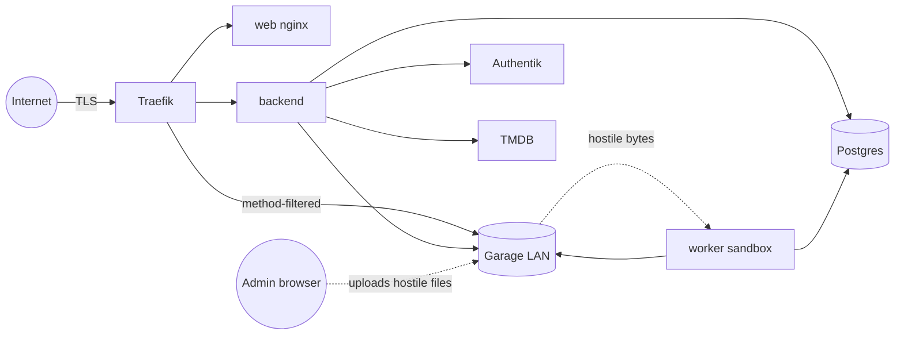

# Threat model

STRIDE per area. Status 2026-11-18, Phase 0 approved with amendments. Each threat has an id that code comments, tests and `docs/DECISIONS.md` can refer to. "Residual" is what stays after the mitigations and is accepted unless you say otherwise.

## 1. Assets

| Asset | Why it matters |
|---|---|
| Authentik sessions and tokens (BFF refresh and ID tokens, mobile tokens) | account takeover, admin takeover |
| Web session cookie | same as above for the web app |
| Admin capability | publish, delete, upload, moderate, read the audit log |
| Media library (sources and encodes) | private content, possibly copyrighted, must not be publicly reachable |
| Playback tokens and presigned URLs | temporary access to media without login |
| Garage keys | API key writes uploads, worker key writes media |
| Database (watch history, lists, comments, requests) | personal data about viewing habits |
| TMDB token, DB passwords, session and playback keys | infrastructure secrets |
| Availability of playback | the main purpose |
| The cluster and the LAN | the worker parses hostile files next to them |

## 2. Trust boundaries

Boundaries: internet to Traefik, Traefik to each backend, API to external services (Authentik, TMDB), uploaded file to ffmpeg, worker to the rest of the cluster.

## 3. Adversaries

- **A1 outsider** on the internet, no account.
- **A2 member**, a signed-in non-admin user who tries to read others' data or escalate.
- **A3 leaked link holder**, someone who obtained a playback URL, presigned URL or a log line.
- **A4 hostile file**, a crafted video, image or subtitle reaching the worker, either uploaded by a compromised admin account or via a malicious TMDB image.
- **A5 compromised component**, an attacker with code execution in the worker or the API.
- **A6 sibling app**, a compromised app on another `*.r16a.cloud` host.

## 4. Threats

### 4.1 Authentication and sessions (T-AUTH)

| Id | STRIDE | Threat | Mitigation | Residual |
|---|---|---|---|---|
| T-AUTH-1 | S | Login CSRF or code injection into the callback | `state` hashed and bound to a `__Host-` flow cookie, PKCE S256, `nonce` checked in the ID token, flow rows expire in 10 min and are single use | none known |
| T-AUTH-2 | S | Open redirect through `returnTo` | same-origin path only, single leading `/`, no backslash or scheme, otherwise `/` | none |
| T-AUTH-3 | S | Session cookie theft through XSS | HttpOnly, strict CSP with nonces and Trusted Types, no `innerHTML` | browser zero-days |
| T-AUTH-4 | S, T | Cookie planted or shadowed by a sibling host (A6) | `__Host-` prefix, `Path=/` (DECISIONS 015) | none |
| T-AUTH-5 | T | CSRF on state-changing endpoints | `SameSite=Strict`, `X-R16a-Request` header, `Origin` equal to the public origin | none |
| T-AUTH-6 | E | Non-member gets in, or a removed member keeps access through refresh | Authentik group binding on all four applications (checked at authorize time only, 2026.2.1 does not re-check on refresh), so the API requires `r16a_stream_user = true` on every login and refresh. The claim includes `is_active`, because refresh does not check it either | Authentik misconfiguration, checked by OPERATING 3 |
| T-AUTH-7 | E | Removed admin or removed member keeps access | web re-reads claims every 5 min through refresh, mobile access tokens live 5 min, both carry the claims recomputed on refresh. Immediate cut with the revoke-sessions admin action plus deleting the user's Authentik sessions and OAuth tokens (SPEC 6.8) | **30-day window**: refresh tokens live 30 days and Authentik does not re-check the group on refresh, so if the claim mapping were broken or removed, a removed user could keep refreshing for up to 30 days. The claim check on every refresh is the control, and OPERATING 8 makes deleting refresh tokens part of every removal |
| T-AUTH-8 | S | Forged mobile JWT | JWKS from discovery over TLS, RS256 allowlist (no `none`, no HS*), `iss`, `aud` = mobile client id, `exp`, `nbf` | none known |
| T-AUTH-9 | I | Database leak exposes Authentik tokens | refresh and ID tokens sealed with `R16A_SESSION_KEY`, session cookie stored as SHA-256 only | leak of database and secret together |
| T-AUTH-10 | D | JWKS refetch storm with random `kid` | refetch at most once a minute | none |
| T-AUTH-11 | S | Mobile authorization code intercepted by an app claiming the custom scheme on Android | PKCE verifier never leaves the app | the attacker app sees the code but cannot redeem it |
| T-AUTH-12 | R | Logout leaves the Authentik session alive | RP-initiated logout runs the provider's own logout flow (User Logout stage, then a static redirect back to the app), refresh tokens revoked for web and mobile | user closes the tab before the redirect completes |
| T-AUTH-13 | S, E | CI test users without MFA are abused | these two accounts are protected by a **password only**. Controls: MFA exception matches the two exact usernames and nothing else, fails safe to MFA on error, user type external, only the r16a-stream groups, access to the dev application only, every other application checked to exclude them, passwords of at least 32 random characters held only in GitHub secrets, used only against the ephemeral CI stack with a loopback guard, rotation every 90 days and on any suspicion (OPERATING 3.2) | a leaked CI password gives member or admin access to the dev application, and to production if someone later adds them to the production application by mistake. The Check access audit is the control for that |
| T-AUTH-14 | D | Parallel refreshes of one session trip Authentik's reuse detection and log the user out | single-flight refresh under a row lock (web) and a client lock (mobile) | none |
| T-AUTH-15 | S, E | One person's tokens from another Authentik instance, or a subject collision, land in someone else's account | users are keyed by Authentik instance origin and `sub` (DECISIONS 071), tokens are still verified against their exact provider issuer and audience, the API refuses web and mobile issuers on different origins, subject mode "hashed user ID" is in the setup checklist | changing a provider's subject mode splits accounts, it cannot merge them |
| T-AUTH-16 | T, I | Own OIDC protocol code gets a rule wrong (DECISIONS 070) | signature, `iss`, `aud`, `exp`, `nbf` from `jsonwebtoken`, protocol rules tested against a mock Authentik for every refusal path, log redaction test over the whole login, no redirects followed toward Authentik, response size cap | a real Authentik behaviour the mock does not model, re-checked on upgrades (DECISIONS section C) |

### 4.2 Authorisation and sharing (T-AZ, T-SHARE)

| Id | STRIDE | Threat | Mitigation | Residual |
|---|---|---|---|---|
| T-AZ-1 | I, E | IDOR on lists, comments, progress, requests | every query filters on the caller in SQL, foreign ids 404, authz matrix test enumerates every route from `openapi.json` | a new route without a matrix row fails CI |
| T-AZ-2 | I | Unpublished titles or non-ready variants visible to users | user queries carry `status = 'published'`, playback requires a ready variant, admin preview only for admins | none |
| T-AZ-3 | E | Non-admin reaches admin routes | `Admin` extractor on every admin handler, 404 otherwise, matrix test | none |
| T-SHARE-1 | T | Recipient edits a shared list | write routes require `owner_id = caller`, shares are read-only | none |
| T-SHARE-2 | I | User directory leaks more than needed | `GET /users?q=` returns id and display name only, minimum 2 characters, rate limited, never email or `sub` | members can enumerate each other's display names, accepted for a private group |
| T-SHARE-3 | I | Revoked share still readable | every read re-checks `list_shares`, no cached grants | none |

### 4.3 Playback URL leakage (T-PLAY)

| Id | STRIDE | Threat | Mitigation | Residual |
|---|---|---|---|---|
| T-PLAY-1 | I | Token in logs (API, Traefik, nginx) | API logs route templates only, `tests/log_redaction.rs`, Traefik access logs off for those routers (needs 3.1 or newer), nginx `access_log off` | Traefik older than 3.1 would need access logs off globally or a filter (Q1) |
| T-PLAY-2 | I | Token or presigned URL leaks through `Referer` | `Referrer-Policy: no-referrer` on the app, API and bucket responses | none |
| T-PLAY-3 | I | A3 shares a playback URL | token valid at most `max(6 h, runtime + 2 h)`, bound to a user who must still exist and be enabled | content viewable by the holder until expiry |
| T-PLAY-4 | I | A3 reuses segment URLs | URLs expire after the token lifetime plus 1 hour, and are not bound to a user (hour rounding makes them shareable) | segments of one title viewable for hours by anyone holding them. Accepted for cacheability |
| T-PLAY-5 | S, T | Forged token | HMAC-SHA256 with a 32-byte key, constant-time compare, domain-separated input | key compromise, rotate with `kid` |
| T-PLAY-6 | T | Playlist rewriting abused to presign arbitrary keys | only lines that match the expected file names under the attempt prefix are presigned, everything else dropped | none |
| T-PLAY-7 | I | Browser history, screenshots, or bug reports contain URLs | playlist URLs are fetched by the player, not navigated, so they do not enter history | user copies a network log |

### 4.4 Upload pipeline and ffmpeg (T-ING, T-WRK)

| Id | STRIDE | Threat | Mitigation | Residual |
|---|---|---|---|---|
| T-ING-1 | D | Oversized upload fills Garage | size declared and capped at 60 GiB at create, part count derived, stored size checked by HEAD on complete and again in the worker, stale uploads aborted after 24 h | an admin can still upload many 60 GiB files |
| T-ING-2 | T | Part URL used for another operation (UploadPartCopy, ListObjects) | Traefik rule requires `PUT`, `partNumber`, `uploadId`, no `X-Amz-Copy-Source`. SigV4 binds the method, key and query | none known |
| T-ING-3 | E | Part URL used to write media | API key has no write on media, init script proves it | none |
| T-ING-4 | T | Subtitle with hostile content | WebVTT parsed and validated by the worker (UTF-8, header, size 2 MiB, cue count), served as `text/vtt` with a sandbox CSP | none known |
| T-ING-6 | D | Uploads fill Garage until writes fail for everything | admission check of source plus ladder estimate against logical free space minus reservations and a floor, serialised, fails closed when capacity is unknown, warning banner, worker re-checks before writing outputs (SPEC 7.10) | estimates are upper bounds, other tenants of Garage can still consume space |
| T-ING-7 | T, D | Source deleted although the encode is incomplete, so content is lost | deletion only after the current attempt from that upload is ready and verified by listing every object back, database check forbids `ready` without verification, delay option, `keep` option (SPEC 7.9) | loss of both Garage nodes, or a later corruption, loses content that has no source. Covered only by the off-cluster backup of the media bucket |
| T-ING-5 | I, E | SSRF through the TMDB lookup or image fetch | fixed base URLs from config, path built from a parsed integer id or a strictly validated file name, no redirects, size and time limits | none |
| T-WRK-1 | E | ffmpeg memory corruption from a crafted file (A4) | non-root, read-only root, all capabilities dropped, seccomp `RuntimeDefault`, no service account token, resource limits, NetworkPolicy, scratch only writable path | a working ffmpeg exploit runs as an unprivileged user with DB and Garage worker credentials (T-WRK-4) |
| T-WRK-2 | I | Demuxer follows references (HLS, concat, `file:` in playlists, HTTP) to read other files or the network | `-protocol_whitelist file`, `-format_whitelist` of container demuxers without reference following, input is a single local path, args are arrays, `env_clear()` | a demuxer bug outside the whitelist logic |
| T-WRK-3 | D | Decompression bomb or endless encode | ffprobe limits (duration, dimensions, frame rate), wall clock limit per job, memory limit on the container, scratch space check | an admin can keep the worker busy |
| T-WRK-4 | E, I | Compromised worker uses its credentials | worker key cannot write uploads, own DB role `r16a_stream_worker` with table and column grants only for jobs, variants, attempts, renditions, images, subtitles and capacity (SPEC 4.9), proven by `tests/db_roles.rs` | the worker can corrupt or delete encodes and job state, and mark variants ready. It cannot read users, sessions, lists, comments, history or the audit log |
| T-WRK-5 | I | Exfiltration from a compromised worker through DNS | egress limited to Postgres, Garage, kube-dns. Calico OSS cannot filter DNS names | DNS queries to attacker domains are resolved by CoreDNS and forwarded upstream, a slow covert channel. Options: CoreDNS policy plugin or `hostAliases` with no DNS at all, both rejected for now as more moving parts |
| T-WRK-6 | T | Worker writes an object with an executable content type | content types from a fixed allowlist, bucket responses carry `sandbox` CSP and `nosniff` | none |

### 4.5 Admin actions (T-ADM)

| Id | STRIDE | Threat | Mitigation | Residual |
|---|---|---|---|---|
| T-ADM-1 | R | Admin denies a destructive action | every admin mutation writes `audit_log` in the same transaction with actor, target, request id | none |
| T-ADM-2 | T | Audit tampering by a compromised API | app role lacks `UPDATE` and `DELETE` on `audit_log` | the owner role can still change it, and it is not handed to the API |
| T-ADM-3 | S | Stolen admin session | same as T-AUTH, plus admin claim refresh every 5 min and the revoke-sessions action | admin actions possible until the session is revoked |
| T-ADM-4 | T | Comment moderation abused | hide is reversible and audited | none |

### 4.6 Exposed bucket routes (T-BKT)

| Id | STRIDE | Threat | Mitigation | Residual |
|---|---|---|---|---|
| T-BKT-1 | I | Listing or anonymous reads | no anonymous access on any bucket, no website mode, `PathRegexp` requires an object key, every request needs a valid signature | Garage auth bugs |
| T-BKT-2 | E | Other S3 operations through the app host | method and query rules, catch-all 403 at priority 1 | none known |
| T-BKT-3 | I | Session cookie reaches Garage | `Cookie` and `Authorization` deleted by a headers middleware on both bucket routers and in the dev and compose proxies, proven by a header-echo test through real Traefik (SPEC 10.3) | none |
| T-BKT-4 | E | Stored XSS by opening an object on the app origin | sandbox CSP, `nosniff`, explicit content types | none known |
| T-BKT-5 | D | One Garage node down sends requests to a dead endpoint | reads use a Traefik service with a passive health check plus retry and a 2 s dial timeout, measured at one 2 s delay per 30 s instead of one per request (DECISIONS 038). Writes have no passive check, so a Garage write refusal cannot mark the healthy node down | uploads stop entirely while a node is down, by design of replication 2 |
| T-BKT-7 | I, E | Garage admin port exposed | only `metrics_token` (read-only) is given to the API, the admin token to nobody in the app, `metrics_token` set so metrics are not public, port 3903 reachable only from cluster nodes by firewall, never routed by Traefik, not allowed for the worker. `tests/garage_compat.rs` asserts admin endpoints refuse no token and the metrics token | `/health` and `/check` answer without a token, revealing cluster health and website-domain existence to anything on the cluster nodes |
| T-BKT-8 | D | Known Garage bugs fixed after 1.0.1 are triggered through the public bucket routes | method and path filtering in Traefik shrinks what reaches Garage, upgrade comparison in DECISIONS 055 | 2.5.0 fixed a panic on invalid UTF-8 in percent-decoded URLs. Whether 1.0.1 is affected is unknown and should be checked before the upgrade decision |
| T-BKT-6 | S | Presigned URL fails or validates for the wrong host | Garage `root_domain` not a suffix of the app host, checked in OPERATING 5, Traefik keeps Host | misconfiguration on rename, listed in the rename checklist |

### 4.7 Infrastructure (T-INF)

| Id | STRIDE | Threat | Mitigation | Residual |
|---|---|---|---|---|
| T-INF-1 | D | Request floods | per-user and per-IP rate limits, body size limits, timeouts on every outbound call | per-replica limits, no global limiter |
| T-INF-2 | D | Slowloris against every app because `websecure` read timeout is 300 s | keep write and idle timeouts at defaults, connection limits reviewed in OPERATING 6 | a slow-request attacker can hold more connections for longer on all cluster apps |
| T-INF-3 | T | Supply chain (crates, npm, actions, base images) | lockfiles, `cargo deny`, `cargo audit`, `npm audit`, OWASP Dependency-Check, Trivy fs and image scans, actions pinned by SHA, base images pinned by digest, Dependabot, every dependency approved | a malicious release that no scanner knows yet |
| T-INF-4 | I | Secrets in logs, errors or the repo | secrets wrapped in `SecretString`, DTOs print `[redacted]`, problem responses never carry input, Trivy secret scan, `secret.yaml` and `.env` git-ignored | none known |
| T-INF-5 | E | Migration role used at runtime | owner URL only in the init container, app role owns nothing | none |
| T-INF-6 | D | Garage replication mistaken for a backup | OPERATING 7 states it, off-cluster backup of the database and the media bucket designed before deployment | until backups exist, a bucket delete is permanent, and with sources deleted by default the encodes are the only copy |
| T-INF-7 | I | Cloudflare record accidentally proxied | DNS-only is documented, trusted proxy list contains only cluster ranges, so proxied traffic would be rate limited per Cloudflare IP, which is visible quickly | none |

### 4.8 Content and user input (T-UGC)

| Id | STRIDE | Threat | Mitigation | Residual |
|---|---|---|---|---|
| T-UGC-1 | T | XSS through comments, list names, request notes | plain text, Angular escapes, Flutter `Text`, length limits, no HTML rendering anywhere | none known |
| T-UGC-2 | I | Private comments shown to others | public query requires `visibility = 'public' and hidden_at is null`, private comments returned only to the author, tests | none |
| T-UGC-3 | D | Comment or request spam | rate limits, length limits, admin hide | a member can still be annoying within the limits |

## 5. Privacy notes

The database holds viewing history, lists and comments per user. No email is stored. Logs hold route templates, status, latency, request id and user id, not IPs beyond what Traefik keeps. OPERATING 8 covers retention and deletion when a user leaves.
